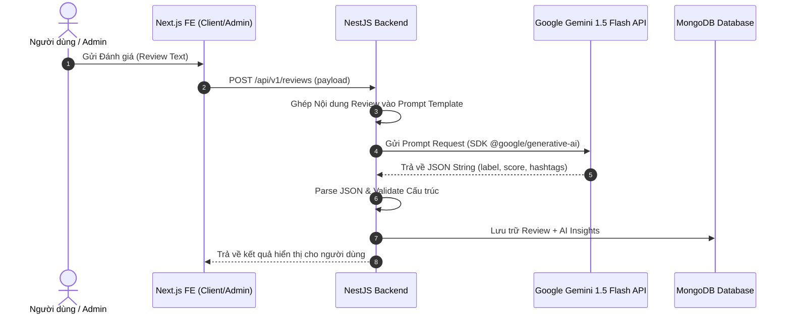

# Tài Liệu Kiến Trúc AI, Prompt Engineering & Testing - GastroWise

Tài liệu này ghi lại chi tiết về **Kiến trúc Kỹ thuật AI**, các **Nguyên lý Lý thuyết AI**, cấu trúc Prompt, tiêu chí Prompt Engineering và quy trình Test cho tính năng Phân tích Sentiment & Trích xuất Hashtags trong hệ thống **GastroWise**.

---

## 1. Các Nguyên Lý & Cấu Trúc AI Trong Dự Án (Phục Vụ Báo Cáo KLTN)

Khi trình bày trong **Báo cáo Khóa luận Tốt nghiệp (KLTN)**, tính năng AI trong dự án GastroWise được xây dựng dựa trên các nguyên lý và kiến trúc khoa học máy tính / AI sau:

### 1.1. Mô hình Kiến trúc Tích hợp AI (AI Architecture Pattern)
* **LLM-as-a-Service (LLMaaS) / Cloud AI Service:** Hệ thống không tự huấn luyện (train) hay host model cục bộ (vì tốn chi phí phần cứng GPUs khổng lồ), mà tích hợp Mô hình Ngôn ngữ Lớn (LLM) thương mại thế hệ mới - **Google Gemini 1.5 Flash** thông qua Official SDK (`@google/generative-ai`).
* **Stateless AI Processing Protocol:** Tiến trình xử lý AI dạng "không lưu trạng thái". Mỗi request phân tích nhận xét là một giao dịch độc lập, truyền thông điệp (Prompt + Review Text) và nhận về kết quả JSON mà không cần lưu lại lịch sử hội thoại (Chat History), giúp tối ưu bộ nhớ và tốc độ xử lý (Latent Speed).

### 1.2. Kỹ thuật & Phương pháp Luận AI (AI Methods & Paradigms)
1. **Zero-Shot Prompting (Prompting Không Cần Mẫu):**
   * *Khái niệm:* Thay vì phải cung cấp hàng trăm ví dụ mẫu (Few-Shot), ta tận dụng tri thức có sẵn (Pre-trained Knowledge) của Transformer Model Gemini 1.5 Flash. Ta chỉ cần định nghĩa rõ quy tắc và định dạng đầu ra mong muốn.
2. **Aspect-Based Sentiment Analysis (ABSA - Phân tích Cảm xúc Theo Khía Cạnh):**
   * *Khái niệm:* Không chỉ phân loại cảm xúc chung của bài viết (`POSITIVE`, `NEGATIVE`, `NEUTRAL`), AI còn thực hiện bóc tách khía cạnh (Aspect Extraction) liên quan đến ngành F&B (Hương vị, Dịch vụ, Không gian, Giá cả) thể hiện qua danh sách `#hashtag`.
3. **Structured Output Generation (Phát sinh Đầu ra Có Cấu trúc):**
   * *Khái niệm:* Ép buộc Mô hình Ngôn ngữ Lớn (vốn có bản chất tự do tạo ra văn bản tự nhiên - Unstructured Text) phải tuân thủ nghiêm ngặt theo **JSON Schema** định sẵn, đóng vai trò làm cầu nối (Middleware Interface) giữa AI và Hệ thống Backend (NestJS).

### 1.3. Luồng Xử lý Dữ liệu Hệ thống (AI Pipeline Architecture)



---

## 2. Mẫu Prompt Thực Tế Của Hệ Thống (System Prompt)

Đây là Prompt chuẩn đang được sử dụng trong Backend (`reviews.service.ts`):

```text
Phân tích nhận xét món ăn/nhà hàng sau và trả về thông tin dưới dạng JSON chuẩn.

Nội dung nhận xét: "{NỘI_DUNG_REVIEW_CỦA_NGƯỜI_DÙNG}"

Yêu cầu output cấu trúc JSON chính xác như sau (không kèm theo markdown code block ```json ... ``` hoặc lời dẫn):
{
  "label": "POSITIVE" | "NEGATIVE" | "NEUTRAL",
  "score": <số thực từ 0.0 đến 1.0 đại diện độ tin cậy/mức độ tích cực>,
  "hashtags": ["<thẻ_1>", "<thẻ_2>", "<thẻ_3>"]
}

Quy tắc hashtags:
- Trích xuất tối đa 3 hashtag nổi bật nhất liên quan đến hương vị, dịch vụ, không gian hoặc giá cả.
- Mỗi hashtag không quá 20 ký tự, viết liền không dấu hoặc có dấu ngắn gọn, bắt đầu bằng dấu #.

Chú ý: Trả về ĐÚNG chuỗi JSON hoàn chỉnh, không bổ sung bất kỳ văn bản giải thích nào khác.
```

---

## 3. Các Tiêu Chí Thiết Kế Prompt (Prompt Engineering Criteria)

Nghiệp vụ Phân tích Đánh giá tuân theo **5 Tiêu chí kỹ thuật quan trọng**:

### ① Tiêu chí Định danh Vai trò & Ngữ cảnh (Context & Role Specification)
* Định hình cho AI biết nó đang phân tích trong lĩnh vực F&B (Món ăn / Nhà hàng) để hiểu đúng các từ ngữ chuyên ngành (*"thanh ngọt"*, *"ngấy"*, *"đậm vị"*, *"phục vụ chậm"*).

### ② Tiêu chí Ràng buộc Định dạng Strict (JSON Constraint)
* Ép AI luôn trả về đúng định dạng JSON để Backend (`JSON.parse()`) đọc được mà không bị lỗi cú pháp.
* Chỉ định rõ tên key (`label`, `score`, `hashtags`) và kiểu dữ liệu.

### ③ Tiêu chí Chuẩn hóa Nhãn & Thang điểm (Classification & Scoring Rules)
* Giới hạn `label` chỉ nằm trong ENUM cố định: `POSITIVE`, `NEGATIVE`, `NEUTRAL`.
* `score` thể hiện biên độ cảm xúc / độ tin cậy từ `0.0` đến `1.0`.

### ④ Tiêu chí Trích xuất Thực thể & Giới hạn (Entity Extraction & Boundaries)
* Rút gọn thông tin dưới dạng `#hashtag` tập trung vào 4 nhóm: **Hương vị, Dịch vụ, Không gian, Giá cả**. Tối đa 3 hashtags, mỗi tag < 20 ký tự.

### ⑤ Tiêu chí Phủ định & Chống Nhiễu (Negative Constraints)
* Yêu cầu nghiêm ngặt: *"Trả về ĐÚNG chuỗi JSON hoàn chỉnh, không bổ sung bất kỳ văn bản giải thích nào khác"* nhằm loại bỏ văn bản thừa hoặc các ký tự bọc markdown.

---

## 4. Quy Trình Test Prompt Cho Người Dùng / Đánh Giá Thực Tế

| Kịch bản Test | Nội dung Review Đầu vào (Input Test) | Kết quả AI Kỳ vọng (Expected Output) |
| :--- | :--- | :--- |
| **1. Review Tích cực** | *"Món phở bò rất ngon, nước dùng đậm đà, nhân viên nhiệt tình 10/10."* | `label`: `POSITIVE`<br>`score`: ~`0.9 - 1.0`<br>`hashtags`: `["#phon ngon", "#nuocdungdamda", "#phucvunhietting"]` |
| **2. Review Tiêu cực** | *"Đồ ăn nguội lạnh, chờ 45 phút mới có món, quán bẩn."* | `label`: `NEGATIVE`<br>`score`: ~`0.1 - 0.2`<br>`hashtags`: `["#doannguoi", "#cholau", "#quanban"]` |
| **3. Review Trung tính** | *"Giá 50k tạm chấp nhận được, vị phở bình thường như mọi quán."* | `label`: `NEUTRAL`<br>`score`: ~`0.5`<br>`hashtags`: `["#giacatapnhan", "#vibinhthuong"]` |
| **4. Review Phức tạp** | *"Bún chả ngon tuyệt nhưng quán đông nên phục vụ khá chậm và chật chội."* | `label`: `POSITIVE` hoặc `NEUTRAL`<br>`hashtags`: `["#bunchangon", "#phucvucham", "#khonggianchat"]` |
| **5. Review Mơ hồ / Ký tự rác (Spam)** | *"asdfghjkl 123456"* | `label`: `NEUTRAL`<br>`score`: `0.5`<br>`hashtags`: `[]` |
| **6. Review Lạc đề (Off-Topic)** | *"Tôi muốn mua một chiếc laptop Dell Core i7"* | `label`: `NEUTRAL`<br>`score`: `0.5`<br>`hashtags`: `[]` (Không tạo hashtag F&B vì không liên quan) |

---

## 5. Xử Lý Các Trường Hợp Ngoại Lệ (Edge Cases & Fallback Mechanism)

Để đảm bảo tính ổn định và chính xác trong thực tế khi người dùng cố tình nhập dữ liệu sai/mơ hồ:

1. **Cơ chế Prompt Guard (Bảo vệ từ Prompt):**
   * Trong Prompt có câu lệnh quy tắc đặc biệt: *"Nếu nhận xét mơ hồ, chứa ký tự vô nghĩa (spam), hoặc HOÀN TOÀN KHÔNG LIÊN QUAN đến ẩm thực/nhà hàng, hãy trả về label: 'NEUTRAL', score: 0.5, hashtags: []."*
2. **Cơ chế Fallback Safety Net ở Backend NestJS:**
   * Nếu AI gặp lỗi kết nối API, hạn ngạch (Quota limit), hoặc AI phản hồi sai định dạng JSON, khối `try-catch` tại `reviews.service.ts` sẽ tự động bắt ngoại lệ và trả về giá trị an toàn mặc định:
   ```typescript
   { label: 'NEUTRAL', score: 0.5, hashtags: [] }
   ```
   * Giúp hệ thống web không bao giờ bị dừng hoạt động (crash) dù người dùng nhập bất kỳ nội dung rác nào.

---

## 6. Tích hợp trong Codebase

* **File Backend:** `KLTN-123-GastroWise-BE/src/reviews/reviews.service.ts`
* **SDK:** `@google/generative-ai`
* **Model ID:** `gemini-1.5-flash`
