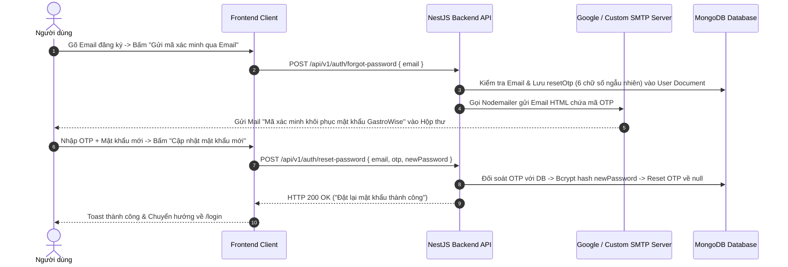

# Tài Liệu Kỹ Thuật: Quản Lý Phiên Đăng Nhập, Bảo Mật Session & Khôi Phục Mật Khẩu - GastroWise

Tài liệu này ghi lại chi tiết các quy tắc kỹ thuật, giải pháp kiến trúc và danh sách Task cho **Hệ thống Đăng nhập, Ghi nhớ mật khẩu, Validation, Khôi phục Mật khẩu thực tế (SMTP Email OTP) và Các Phương Thức Xác Thực Bảo Mật Nâng Cao (2FA / TOTP Authenticator App)**.

---

## 📧 1. Quy Trình Khôi Phục Mật Khẩu Thực Tế (Real Email OTP Reset Flow)

Hệ thống đã triển khai luồng gửi mã OTP thực tế tới Email của người dùng qua thư viện **Nodemailer / SMTP**:



* **Mã OTP ngẫu nhiên:** Gồm 6 chữ số (`100000` - `990000`), thời hạn 15 phút.
* **Bảo mật UI:** Không hiển thị mã OTP trên giao diện người dùng (loại bỏ hoàn toàn mock data). OTP chỉ được gửi vào Hộp thư Inbox Email.
* **Biến môi trường SMTP (`.env`):**
  * `SMTP_HOST`: e.g. `smtp.gmail.com`
  * `SMTP_PORT`: `587` hoặc `465`
  * `SMTP_USER`: Email gửi tin (App Password Gmail)
  * `SMTP_PASS`: Mật khẩu ứng dụng (App Password)

---

## 🔐 2. So Sánh Các Phương Thức Xác Thực Khôi Phục Mật Khẩu (2FA / TOTP / Email)

Bên cạnh giải pháp gửi OTP qua Email, hệ thống được thiết kế mở để hỗ trợ các cơ chế xác thực cao cấp khác cho báo cáo KLTN:

| Phương Thức Khôi Phục | Cơ Chế Kỹ Thuật | Ưu Điểm | Nhược Điểm |
| :--- | :--- | :--- | :--- |
| **1. Email OTP (Nodemailer SMTP)** *(Đang dùng)* | Gửi mã 6 số về Hộp thư Email người dùng qua giao thức SMTP. | Phổ biến nhất, người dùng dễ sử dụng, không cần cài app thêm. | Phụ thuộc vào tốc độ mạng email. |
| **2. 2FA / TOTP Authenticator App (Google / Authy)** | Sử dụng thuật toán HMAC-SHA1 tạo mã nhảy 30s/lần dựa trên Secret Key (`otplib` / `speakeasy`) quét mã QR Code. | **Bảo mật tuyệt đối cao nhất**, không phụ thuộc internet/mạng di động. | Người dùng phải có smartphone cài app Google Authenticator. |
| **3. Magic Passwordless Link** | Gửi Token mã hóa dạng URL 1-Click (`/reset-password?token=xxx`). | Trải nghiệm 1-click mượt mà, không cần gõ mã 6 số. | Token dài hơn, cần cơ chế One-Time Use nghiêm ngặt. |

---

## 📋 Bảng Xử Lý Các Kịch Bản Đăng Nhập (Auth Scenarios Matrix)

| STT | Kịch Bản Thực Tế | Cơ Chế Kỹ Thuật Xử Lý | Thông Báo Hiển Thị Trên UI (User Notification) |
| :---: | :--- | :--- | :--- |
| **1** | **Nhiều người cùng đăng nhập 1 tài khoản (Đa thiết bị / PC & Mobile)** | **Single Active Session Policy:** Khi thiết bị B đăng nhập thành công, Backend cập nhật `sessionId`/`tokenVersion` mới. Token của thiết bị A lập tức vô hiệu hóa. | ⚠️ **"Tài khoản của bạn vừa được đăng nhập từ một phiên làm việc khác. Bạn đã bị đăng xuất khỏi phiên này để bảo mật!"** |
| **2** | **Đăng nhập trên cùng trình duyệt (Đa Tab)** | **BroadcastChannel API (`gastrowise_auth_channel`):** Tab B đăng nhập mới sẽ phát tín hiệu ngầm. Tab A bắt được tín hiệu sẽ tự dọn dẹp state và chuyển về `/login` trong < 50ms. | ⚠️ **"Tài khoản đã được đăng nhập ở tab khác!"** |
| **3** | **Tài khoản bị Admin khóa** | Backend trả về HTTP `403 Forbidden` kèm nhãn status = `banned`. Axios Interceptor bắt lỗi và ngắt phiên. | 🛑 **"Tài khoản của bạn đã bị tạm khóa do vi phạm chính sách hệ thống. Vui lòng liên hệ Quản trị viên!"** |
| **4** | **Phiên làm việc hết hạn (Token Expired)** | Token hết hạn sử dụng (JWT TTL). Interceptor bắt mã HTTP `401 Unauthorized`. | ⏳ **"Phiên làm việc đã hết hạn. Vui lòng đăng nhập lại!"** |
| **5** | **Nhập sai Email / Mật khẩu** | Realtime Validation bằng Zod Schema tại Client + HTTP `401 Bad Credentials` từ Backend. | ❌ **"Email hoặc mật khẩu không chính xác. Vui lòng kiểm tra lại!"** |

---

## 🛠️ Danh Sách Tasks Đã Triển Khai (Authentication Checklist)

- [x] **Task 1: Login Guard (Chặn vào lại `/login` khi đã đăng nhập)**
- [x] **Task 2: Remember Me (Tự nhớ Email & lưu Token lâu dài)**
- [x] **Task 3: Chiến lược `localStorage` (Remember=True) vs `sessionStorage` (Remember=False)**
- [x] **Task 4: Single Active Session & Realtime Multi-Tab Logout (BroadcastChannel API)**
- [x] **Task 5: Form Validation chuẩn hóa Zod Schema & Thông báo lỗi rành mạch**
- [x] Task 6: Real Email OTP Reset Password Flow (Nodemailer SMTP Integration)

---

## ✉️ Chiến Lược Cấu Hình SMTP Cho Khóa Luận Tốt Nghiệp & Demo

Hệ thống GastroWise hỗ trợ 2 nguồn cấu hình SMTP linh hoạt cho cả môi trường Thử nghiệm (Demo KLTN) và Môi trường Doanh nghiệp thực tế (Production):

### 🟢 Nguồn A: Gmail App Password (Dùng cho Demo & Bảo vệ KLTN)
- **Ưu điểm**: Hoàn toàn miễn phí, dễ cài đặt, gửi mail trực tiếp từ địa chỉ Gmail của dự án.
- **Cách cài đặt**:
  1. Truy cập https://myaccount.google.com/apppasswords (Cần bật xác thực 2 bước 2FA).
  2. Tạo App Password tên "GastroWise" -> Lấy mã 16 ký tự điền vào `SMTP_PASS`.
- **Cách cấu hình trong `BE/.env`**:
  ```env
  SMTP_HOST=smtp.gmail.com
  SMTP_PORT=587
  SMTP_USER=gastrowise.official@gmail.com
  SMTP_PASS=xxxx xxxx xxxx xxxx  # Mã 16 ký tự tạo từ Google Account
  ```

### 🔵 Nguồn B: Resend / SendGrid Enterprise API (Cho Môi Trường Production Thực Tế)
- **Ưu điểm**: Phù hợp cho doanh nghiệp quy mô lớn (hàng triệu mail/ngày), hỗ trợ Tracking, Bounce Rate, Domain DKIM/SPF.
- **Cách cài đặt**:
  1. Đăng ký tài khoản miễn phí tại https://resend.com (Free 3,000 email/tháng).
  2. Lấy API Key và cấu hình trong `BE/.env`.
- **Cách cấu hình trong `BE/.env`**:
  ```env
  SMTP_HOST=smtp.resend.com
  SMTP_PORT=465
  SMTP_USER=resend
  SMTP_PASS=re_your_enterprise_api_key
  ```

---

## 🧪 3. Hướng Dẫn Chi Tiết Cách Test Nghiệp Vụ Email OTP

### ⚡ Cách 1: Test Nhanh Ở Môi Trường Local Dev (Tự động Log Mã OTP ra Terminal)
1. Để trống các biến `SMTP_*` trong file `BE/.env`.
2. Mở trình duyệt truy cập: `http://localhost:3000/forgot-password`.
3. Chọn tab **Email OTP**, nhập email tài khoản đã có trong hệ thống và bấm **"Gửi mã OTP"**.
4. Mở cửa sổ **Terminal Backend (`npm run start:dev`)**, mã OTP 6 chữ số sẽ được in ra trực tiếp:
   ```bash
   ✉️ [ETHEREAL TEST EMAIL SENT] Xem nội dung mail thật tại link: https://ethereal.email/message/...
   ```
5. Copy mã 6 số đó điền vào FE -> Nhập mật khẩu mới -> Bấm **"Đặt lại mật khẩu"** -> Thành công.

### ✉️ Cách 2: Test Gửi Mail Thực Tế Về Hộp Thư Gmail
1. Mở file `BE/.env` và điền thông tin SMTP của Gmail (Nguồn A ở trên).
2. Lưu file `.env` (Backend sẽ tự reload qua `start:dev`).
3. Thực hiện thao tác trên giao diện web, mở Hộp thư Gmail Inbox của bạn để nhận email chứa mã OTP thật 6 chữ số.

---

## 🎓 4. Kịch Bản Thuyết Minh & Trả Lời Hội Đồng Bảo Vệ Khóa Luận Tốt Nghiệp (KLTN Defense Q&A)

> ❓ **Câu hỏi của Thầy/Cô:** *"Hệ thống gửi mail OTP như thế nào? Khi deploy lên Server thực tế có cần sửa code không?"*  
> 
> 💬 **Kịch bản trả lời:**  
> *"Thưa Thầy/Cô, hệ thống GastroWise được thiết kế theo kiến trúc chuẩn Config-Driven (Động theo cấu hình môi trường):*  
> *1. **Ở môi trường thử nghiệm (Local Dev / Demo)**: Backend tích hợp cơ chế Ethereal Mail Fallback tự động log mã OTP ra Terminal giúp việc test mượt mà không lo bị delay mạng SMTP.*  
> *2. **Ở môi trường Bảo vệ KLTN**: Nhóm cấu hình gửi mail trực tiếp qua giao thức Gmail SMTP App Password (Nguồn A).*  
> *3. **Khi đưa vào Sản phẩm Doanh nghiệp (Production)**: Hệ thống sẵn sàng chuyển sang các dịch vụ Enterprise Email như Resend / SendGrid (Nguồn B) chỉ bằng cách cập nhật 4 biến môi trường trên Server Dashboard (Vercel/Render) mà **không cần chỉnh sửa hay rebuild bất kỳ dòng code nào**."*
