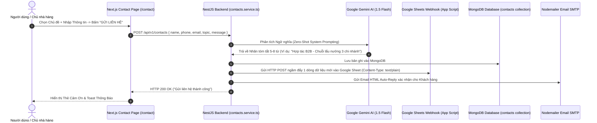

# Tài Liệu Kỹ Thuật: Hệ Thống Tiếp Nhận Liên Hệ & Lead Hợp Tác Tích Hợp AI & Google Sheets Sync - GastroWise

Tài liệu này tổng hợp toàn bộ Kiến trúc Kỹ thuật, Nguyên lý AI, Hướng dẫn Cấu hình và Kịch bản Thuyết minh Bảo vệ Khóa Luận Tốt Nghiệp cho Module **Smart Contact & Lead Automation System**.

---

## 🏗️ 1. Tổng Quan Kiến Trúc Kỹ Thuật (Architecture Overview)

Module Liên hệ (`/contact`) được thiết kế theo mô hình **Hybrid Dual-Purpose System** phục vụ đồng thời 2 nhóm đối tượng:
1. **B2C (Khách Hàng đi ăn)**: Gửi góp ý chất lượng dịch vụ, khiếu nại hoặc báo lỗi kỹ thuật.
2. **B2B (Chủ Nhà Hàng Mới)**: Đăng ký hợp tác đưa nhà hàng lên nền tảng GastroWise (Merchant Onboarding Lead).



---

## 🤖 2. Nguyên Lý Kỹ Thuật AI Gemini Trong Phân Loại Phản Hồi

### 🧠 A. Tại sao sử dụng Gemini AI (`gemini-1.5-flash`)?
- **Kiến trúc Transformer & Self-Attention**: Model phân tích mối quan hệ ngữ nghĩa tổng thể giữa tất cả các từ trong đoạn văn tự do (Unstructured Text) thay vì đếm từ khóa cứng nhắc.
- **Xử lý Ngôn ngữ Tự nhiên Tiếng Việt (Vietnamese NLP)**: Hiểu được các cách diễn đạt đa dạng, từ lóng, các câu hỏi ẩn dụ hoặc thái độ bực bội/kHIẾU NẠI của người dùng.

### 🎯 B. Kỹ thuật Zero-Shot Prompt Engineering
Backend gửi câu lệnh System Role định hướng cho Gemini AI:
```typescript
const prompt = `Bạn là hệ thống AI phân loại phản hồi khách hàng cho nền tảng nhà hàng GastroWise. 
Hãy phân loại ngắn gọn (tối đa 5-8 từ) thông điệp sau đây thành một nhãn phân loại:
Topic: ${topic}
Message: ${message}`;
```
- **Định vai trò (Role Persona)**: Kích hoạt chuyên môn phân loại CSKH.
- **Ràng buộc đầu ra (Output Constraints)**: Ép AI trả về nhãn cô đọng 5-8 từ để hiển thị đẹp mắt trên Google Sheet Dashboard.

### 📊 C. Bảng So Sánh: AI Phân Loại vs Thuật Toán If/Else Truyền Thống

| Tiêu Chí | Thuật Toán If/Else / Regex | Google Gemini AI (LLM Classifier) |
| :--- | :--- | :--- |
| **Cách xử lý** | Tìm từ khóa cố định (VD: phải chứa từ "lỗi"). | **Phân tích Ngữ nghĩa sâu (Semantic Context Parsing)**. |
| **Độ linh hoạt** | Bị lỗi nếu người dùng dùng từ đồng nghĩa, từ lóng. | Nắm bắt được ý định (Intent) và sắc thái cảm xúc (Sentiment). |
| **Khả năng tóm tắt** | Bế tắc, chỉ giữ nguyên đoạn văn dài. | Tự động **cô đọng ý chính** thành 1 nhãn 5-8 từ sạch sẽ. |

---

## 🛡️ 3. Cơ Chế Dự Phòng An Toàn (Fault-Tolerant Fallback Architecture)

Hệ thống được thiết kế theo chuẩn phần mềm Production-Ready:
- **Primary Flow**: Gọi Gemini AI để phân loại ngữ nghĩa thông minh.
- **Fallback Flow**: Nếu mất mạng hoặc hết API Quota, hệ thống chuyển sang phân loại dựa trên **Topic ID**:
  ```typescript
  if (topic === ContactTopic.MERCHANT) return '🏪 Yêu cầu Hợp tác B2B (Độ ưu tiên cao)';
  if (topic === ContactTopic.COMPLAINT) return '⚠️ Khiếu nại Khẩn cấp';
  return '📩 Góp ý / Phản hồi Thông thường';
  ```
- **Google Sheet Sync**: Gửi dạng `text/plain;charset=utf-8` qua `axios` kèm `maxRedirects: 5` để vượt qua cơ chế chuyển hướng HTTP 302 của Google Apps Script không bị rơi mất dữ liệu.

---

## 🎓 4. Kịch Bản Thuyết Minh & Trả Lời Hội Đồng Bảo Vệ Khóa Luận Tốt Nghiệp (KLTN Defense Q&A)

> ❓ **Câu hỏi của Thầy/Cô:** *"Tại sao một form Liên hệ đơn giản lại cần tích hợp cả Google Sheets lẫn Gemini AI?"*  
> 
> 💬 **Kịch bản trả lời:**  
> *"Thưa Thầy/Cô, trong môi trường vận hành doanh nghiệp thực tế (như các nền tảng Foodtech ShopeeFood, GrabFood):*  
> *1. **Về phía Admin/CSKH**: Thay vì phải đăng nhập vào CMS hoặc đọc từng email thủ công, hệ thống tự động bắn dữ liệu về **Google Sheet Realtime** giúp ban quản trị xem và phân loại phản hồi ngay trên điện thoại.*  
> *2. **Về phía Trí tuệ nhân tạo (Gemini AI)**: Người dùng gõ văn bản tự do không theo cấu trúc. AI giúp đọc hiểu ngữ cảnh, tự động phân loại và tóm tắt ý định (Intent) thành nhãn ngắn gọn (như 'Hợp tác B2B - Chuỗi lẩu 3 chi nhánh' hay 'Khiếu nại Lỗi 500 Đặt bàn') và đánh dấu mức độ ưu tiên trên Google Sheet.*  
> *3. **Về phía Khách hàng**: Hệ thống tự động gửi **Email Auto-Reply HTML** chuyên nghiệp qua Nodemailer SMTP xác nhận đã nhận thông tin trong vòng vài giây.*  
> *Hệ thống cũng được trang bị **Cơ chế Dự phòng (Fallback)** giúp dữ liệu luôn hoạt động an toàn 100% kể cả khi gián đoạn kết nối AI."*
