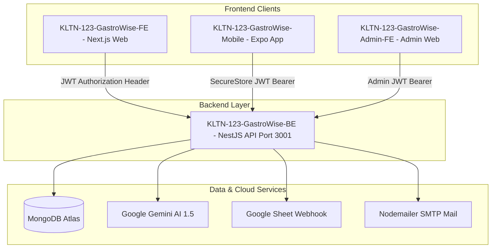

# Tài Liệu Kỹ Thuật & Công Cụ Công Nghệ - GastroWise Mobile App

Tài liệu này tổng hợp toàn bộ danh sách Công nghệ, Thư viện, Công cụ và Kiến trúc được sử dụng trong dự án **GastroWise Mobile App**, dùng để phục vụ quá trình phát triển và làm tư liệu viết **Báo cáo Khóa Luận Tốt Nghiệp (KLTN Docs)**.

---

## 🛠️ 1. Danh Sách Công Nghệ & Thư Viện Sử Dụng (Tech Stack & Tools)

| Phân Loại | Công Nghệ / Thư Viện | Phiên Bản | Mục Đích Sử Dụng Trong Khóa Luận |
| :--- | :--- | :--- | :--- |
| **Core Framework** | **React Native** | `~0.86` | Framework xây dựng ứng dụng di động native đa nền tảng (iOS & Android). |
| **Development Platform** | **Expo SDK** | `~57.0` | Nền tảng quản lý build, chạy máy thật qua **Expo Go**, hỗ trợ camera QR, Push Notifications. |
| **Ngôn ngữ** | **TypeScript** | `~6.0` | Đảm bảo tính chặt chẽ của kiểu dữ liệu, bắt lỗi compile-time và đồng bộ kiểu dữ liệu với Backend. |
| **Điều hướng (Routing)** | **Expo Router** | Latest | File-based Routing hệ thống màn hình chuẩn Next.js (Stack, Tabs, Modals). |
| **Lưu trữ An toàn** | **Expo SecureStore** | Latest | Lưu trữ Token JWT mã hóa phần cứng trên iOS Keychain & Android Keystore. |
| **Quản lý Trạng thái** | **Zustand** | Latest | State Management nhẹ, hiệu năng cao quản lý Auth State (`user`, `token`, `isLoggedIn`). |
| **Kết nối API** | **Axios Interceptor** | Latest | Tự động đính kèm `Authorization: Bearer <token>` và xử lý lỗi kết nối Backend API. |
| **Thiết kế Giao diện (UI)** | **NativeWind (Tailwind CSS)** | `v4` | Sử dụng các utility class Tailwind CSS nguyên bản cho React Native (`className="..."`). |
| **Bộ Icon Vector** | **Lucide React Native** | Latest | Bộ icon thiết kế hiện đại, sắc nét chuẩn UI/UX di động. |
| **Validation** | **Zod Schema** | Latest | Kiểm tra dữ liệu đầu vào Form (Email, SĐT Việt Nam, Password) tại Client. |

---

## 🏛️ 2. Mẫu Kiến Trúc Kết Nối (Web & Mobile Shared Backend)



---

## 🌐 3. Cấu Hình Địa Chỉ API Backend (Network Strategy)

### 🔴 Cách 1: Sử dụng Tunnel Mode (Không cần đổi IP khi khác Wi-Fi hoặc dùng 4G/5G)
- Chạy lệnh khởi động với flag `--tunnel`:
  ```bash
  npx expo start --tunnel
  ```
- Expo sẽ tự động tạo một đường truyền ngrok tunnel an toàn để điện thoại 4G/5G kết nối trực tiếp với máy tính của bạn mà không lo gián đoạn mạng.

### 🟢 Cách 2: Cấu hình địa chỉ IP máy tính trong file `.env` của Mobile App
1. Mở Terminal gõ `ipconfig` trên máy tính để tìm **`IPv4 Address`** của mạng Wi-Fi (Ví dụ: `192.168.1.15`).
2. Mở file [`.env`](file:///d:/GastroWise/KLTN-123-GastroWise-Mobile/.env) trong thư mục `KLTN-123-GastroWise-Mobile` và điền:
   ```env
   EXPO_PUBLIC_API_URL=http://192.168.1.15:3001/api/v1
   ```
3. Khi Deploy cho Thầy Cô test Production:
   ```env
   EXPO_PUBLIC_API_URL=https://api-gastrowise.onrender.com/api/v1
   ```

---

## 📂 4. Cấu Trúc Thư Mục Dự Án (Project Directory Structure)

```
KLTN-123-GastroWise-Mobile/
├── assets/                 # Hình ảnh, Logo, Font chữ ứng dụng
├── src/
│   ├── app/                # Expo Router Màn hình & Điều hướng
│   │   ├── (auth)/         # Group màn hình Xác thực (Login, Register, Forgot-Password)
│   │   ├── (tabs)/         # Bottom Tab Bar (Trang chủ, Khám phá, Đơn đặt, Cá nhân)
│   │   ├── restaurant/     # Chi tiết Nhà hàng & Đặt bàn
│   │   └── _layout.tsx     # Root Stack Layout
│   ├── components/         # Reusable Component UI (Button, Input, Card, Modal)
│   ├── constants/          # Định nghĩa Route, API Endpoints, Color Tokens
│   ├── lib/
│   │   └── api/            # Axios Client & Interceptor
│   ├── store/              # Zustand Auth Store & App State
│   └── types/              # TypeScript Types & Interfaces
├── app.json                # Cấu hình Expo Project
└── package.json            # Thư viện & Dependencies
```
