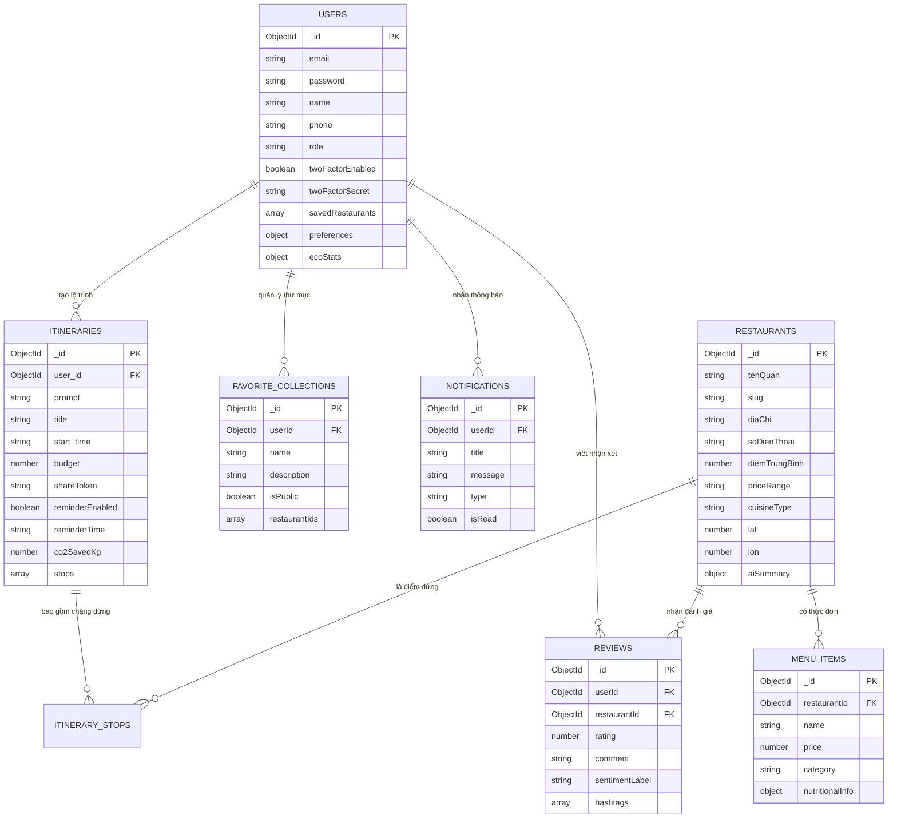

# Tài Liệu Thiết Kế Cơ Sở Dữ Liệu (Database Schema Specification) - GastroWise

Tài liệu này chi tiết hóa cấu trúc Cơ sở dữ liệu MongoDB Atlas (NoSQL), danh sách các Collection, Bảng ánh xạ Schema và Mối quan hệ thực thể (ERD Diagram) cho hệ thống **GastroWise**.

---

## 📐 1. Sơ Đồ Mối Quan Hệ Thực Thể (Entity Relationship Diagram - ERD)

---

## 🗄️ 2. Chi Tiết Cấu Trúc Các Collection Cần Thiết Cho Khóa Luận

### 1. Collection `users` (Quản Lý Người Dùng & Khẩu Vị AI)
- `_id`: ObjectId (Primary Key).
- `email`: String (Unique, Indexed) - Email đăng nhập.
- `password`: String - Mật khẩu đã mã hóa `bcrypt`.
- `name`: String - Họ và tên đầy đủ.
- `phone`: String - Số điện thoại liên hệ.
- `role`: String Enum (`user`, `owner`, `admin`) - Phân quyền hệ thống.
- `twoFactorEnabled`: Boolean - Trạng thái bảo mật 2FA TOTP.
- `twoFactorSecret`: String - Mã secret key mã hóa Google Authenticator.
- `savedRestaurants`: Array<ObjectId> - Danh sách ID nhà hàng yêu thích.
- `preferences`: Object ({ cuisineTags: Array, priceRange: String, maxDistance: Number }) - Khẩu vị cá nhân hóa.
- `ecoStats`: Object ({ totalKmSaved: Number, co2SavedKg: Number }) - Chỉ số tích lũy di chuyển xanh.

---

### 2. Collection `restaurants` (Danh Mục Nhà Hàng & Địa Điểm Ẩm Thực)
- `_id`: ObjectId (Primary Key).
- `tenQuan` / `name`: String (Indexed) - Tên nhà hàng.
- `slug`: String (Unique, Indexed) - URL thân thiện SEO.
- `diaChi` / `address`: String - Địa chỉ chi tiết.
- `soDienThoai` / `phone`: String - Hotline liên hệ.
- `diemTrungBinh` / `rating`: Number (1.0 - 5.0) - Điểm đánh giá trung bình.
- `priceRange`: String - Khoảng giá tham khảo (VD: "150.000đ - 300.000đ").
- `cuisineType`: String - Loại hình ẩm thực (Lẩu Nướng, Món Việt, Cafe, Hải Sản).
- `lat`: Number & `lon`: Number - Tọa độ địa lý GPS.
- `aiSummary`: Object ({ positives: Array<String>, negatives: Array<String> }) - Tóm tắt ưu/nhược điểm bằng Gemini AI.

---

### 3. Collection `itineraries` (Lộ Trình Food Tour Tối Ưu Đường Đi)
- `_id`: ObjectId (Primary Key).
- `user_id`: ObjectId (ref: User) - Người khởi tạo lộ trình.
- `prompt`: String - Nhu cầu tìm kiếm ban đầu của người dùng.
- `title`: String - Tên lộ trình Food Tour (VD: "Lẩu Nướng Đêm Gò Vấp").
- `start_time`: String - Thời gian khởi hành.
- `budget`: Number - Mức ngân sách dự kiến.
- `shareToken`: String (Unique) - Mã 8 ký tự phục vụ **Chia Sẻ 1-Click QR Code & Deep Link**.
- `reminderEnabled`: Boolean - Đã bật **Nhắc Nhở Khởi Hành** hay chưa.
- `reminderTime`: String Enum (`30_MIN`, `1_HOUR`, `2_HOUR`) - Khoảng thời gian nhắc trước.
- `co2SavedKg`: Number - Lượng CO2 giảm phát thải tương đương (mặc định 1.5kg).
- `stops`: Array<Object> ({ stop_id, restaurant_id, order_index, restaurant_name, restaurant_lat, restaurant_lng }) - Danh sách các chặng dừng đã xếp thứ tự di chuyển tối ưu đường đi ngắn nhất.

---

### 4. Collection `favorite_collections` (Bộ Sưu Tập Theo Chủ Đề)
- `_id`: ObjectId (Primary Key).
- `userId`: ObjectId (ref: User) - Chủ sở hữu bộ sưu tập.
- `name`: String - Tên thư mục bộ sưu tập (VD: "Quán Khuya", "Hẹn Hò 2 Người").
- `description`: String - Mô tả bộ sưu tập.
- `isPublic`: Boolean - Trạng thái chia sẻ công khai.
- `restaurantIds`: Array<ObjectId> (ref: Restaurant) - Danh sách các nhà hàng thuộc thư mục này.

---

### 5. Collection `reviews` (Đánh Giá & Phân Tích Cảm Xúc AI Sentiment)
- `_id`: ObjectId (Primary Key).
- `userId`: ObjectId (ref: User) - Tác giả bài nhận xét.
- `restaurantId`: ObjectId (ref: Restaurant) - Nhà hàng được đánh giá.
- `rating`: Number (1 - 5★) - Số sao đánh giá.
- `comment`: String - Nội dung bài viết.
- `photos`: Array<String> - Đường dẫn ảnh đính kèm.
- `sentimentLabel`: String Enum (`POSITIVE`, `NEUTRAL`, `NEGATIVE`) - Nhãn phân tích thái độ của Gemini AI.
- `hashtags`: Array<String> - Hashtags trích xuất tự động bằng AI.

---

### 6. Collection `notifications` (Thông Báo Nhắc Nhở & Weather Alert)
- `_id`: ObjectId (Primary Key).
- `userId`: ObjectId (ref: User) - Người nhận thông báo.
- `title`: String - Tiêu đề thông báo.
- `message`: String - Nội dung chi tiết.
- `type`: String Enum (`ITINERARY_REMINDER`, `WEATHER_RECOMMENDATION`, `SYSTEM`).
- `itineraryId`: ObjectId (ref: Itinerary) - Chuyến đi liên quan.
- `isRead`: Boolean - Trạng thái đã đọc.
