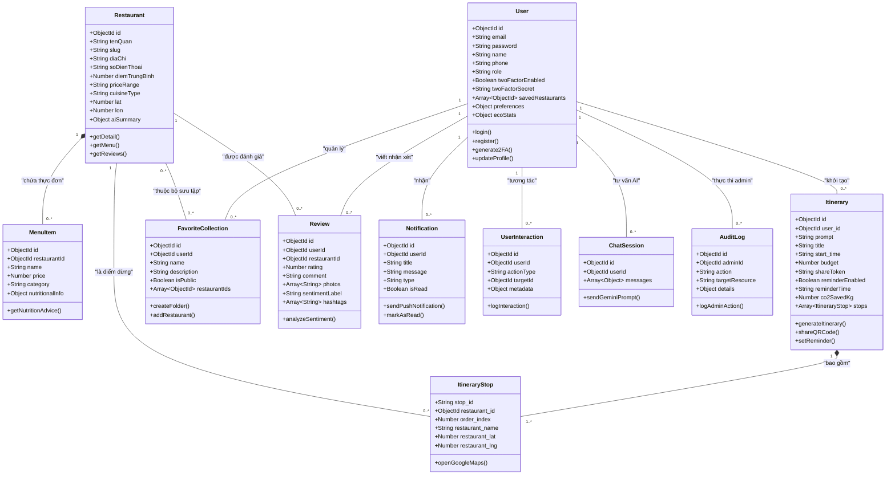

# Tài Liệu Thiết Kế Sơ Đồ Lớp (UML Class Diagram Specification) - GastroWise

Tài liệu này tổng hợp toàn bộ **Sơ đồ Lớp (UML Class Diagram)** và định nghĩa chi tiết các Lớp Đối Tượng (Classes), Thuộc tính (Attributes) & Phương thức (Methods) của hệ thống **GastroWise**, giúp sinh viên dễ dàng chèn vào Báo cáo Khóa luận tốt nghiệp.

---

## 📐 1. Sơ Đồ Lớp Tổng Thể (Full UML Class Diagram)

---

## 🗄️ 2. Danh Sách Đầy Đủ 11 Collection & Ý Nghĩa Kỹ Thuật

| STT | Tên Collection MongoDB | Lớp Tương Ứng (UML Class) | Chức Năng Nghiệp Vụ Trong Hệ Thống |
| :---: | :--- | :--- | :--- |
| **1** | `users` | `User` | Quản lý người dùng, phân quyền (User/Owner/Admin), 2FA TOTP, Hồ sơ AI Taste DNA & Thống kê Eco. |
| **2** | `restaurants` | `Restaurant` | Danh mục nhà hàng, tọa độ địa lý GPS, hotline, rating và Tóm tắt ưu/nhược điểm bằng Gemini AI. |
| **3** | `menu_items` | `MenuItem` | Thực đơn điện tử, phâm loại món (Chính, Phụ, Uống, Tráng miệng) & Chỉ số calo đạm/béo AI Nutri. |
| **4** | `itineraries` | `Itinerary` | Lộ trình Food Tour 3 chặng tối ưu đường đi ngắn nhất, mã `shareToken` QR Code, nhắc nhở & chỉ số CO2. |
| **5** | `favorite_collections` | `FavoriteCollection` | Thư mục bộ sưu tập yêu thích tùy chỉnh theo chủ đề (*"Quán Khuya"*, *"Hẹn hò 2 người"*). |
| **6** | `reviews` | `Review` | Bài đánh giá cộng đồng, số sao, hình ảnh và Nhãn tự động phân tích cảm xúc AI Sentiment. |
| **7** | `notifications` | `Notification` | Thông báo nhắc nhở lịch trình Food Tour thời gian thực và Cảnh báo gợi ý theo thời tiết. |
| **8** | `user_interactions` | `UserInteraction` | Nhật ký hành vi người dùng (lượt xem, lượt click) phục vụ thuật toán Recommendation Engine. |
| **9** | `chat_sessions` | `ChatSession` | Lịch sử đoạn hội thoại tư vấn ẩm thực trực tuyến với Gemini AI Chatbot. |
| **10** | `contacts` | `Contact` | Thông tin liên hệ tư vấn & đầu tư nhà hàng đồng bộ Google Sheets. |
| **11** | `audit_logs` | `AuditLog` | Nhật ký thao tác quản trị viên trên Admin CMS/CRM (khóa user, duyệt review, cập nhật vai trò). |

---

## 🔗 3. Mối Quan Hệ Giữa Các Lớp (Relationships Breakdown)

1. **Aggregation & Composition (Quy tụ & Cấu thành)**:
   - `Itinerary` $\rightarrow$ `ItineraryStop`: Quan hệ Composition (Một lộ trình bao gồm nhiều chặng dừng, khi xóa Lộ trình các chặng dừng bị hủy).
   - `Restaurant` $\rightarrow$ `MenuItem`: Quan hệ Composition (Một nhà hàng có nhiều món ăn trong thực đơn).
2. **Association (Hiệp hội)**:
   - `User` $\leftrightarrow$ `Itinerary`: 1-n (Một người dùng có thể khởi tạo nhiều lộ trình Food Tour).
   - `User` $\leftrightarrow$ `Review` $\leftrightarrow$ `Restaurant`: Mối quan hệ 3 bên giữa tác giả, bài nhận xét và nhà hàng.
   - `FavoriteCollection` $\leftrightarrow$ `Restaurant`: n-n (Một bộ sưu tập chứa nhiều nhà hàng và một nhà hàng có thể thuộc nhiều bộ sưu tập).
