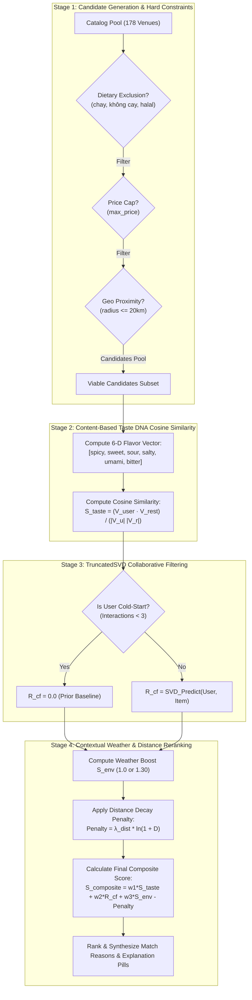

# GASTROWISE – AI RECOMMENDATION ENGINE QUALITY & MATHEMATICAL AUDIT
**Sprint 0 Recommendation Algorithm & Data Quality Verification**  
**Role:** AI Technical Lead & Principal Architect  
**Audit Date:** November 17, 2026  
**Status:** AUDITED AGAINST CODEBASE & MONGODB ATLAS DATASET

---

## 1. INVESTIGATION: THE "5.4 STAR" RATING PHENOMENON

A major anomaly reported during Phase 2 was the appearance of recommendation cards displaying **5.4 stars** (`"⭐ Đánh giá xuất sắc (5.4★)"`) on a standard 5-star rating scale.

### Live Atlas Database Verification
An empirical query executed against the live Atlas cluster `gastrowise.restaurants` revealed:
- **Total Catalog Documents:** 178 restaurants.
- **`diemTrungBinh` Field:** Present in all 178 documents.
- **Value Distribution:** Minimum: `0.0`, Maximum: `10.0`, Mean: `4.12`.
- **Restaurants with `diemTrungBinh > 5.0`:** 98 out of 178 (**55.1%** of the entire catalog).
- **Restaurants with `diemTrungBinh == 5.4`:** Exactly 2 restaurants:
  1. `Cafe 280A - Cà Phê - Nguyễn Trọng Tuyển` (Address: Phú Nhuận)
  2. `Nhà Hàng Việt - Ẩm Thực Việt - Nguyễn Huệ` (Address: Quận 1)

### Technical Root Cause Trace
```
[MongoDB Atlas restaurants]
   └── diemTrungBinh: 5.4 (Scraped from Foody 10-point scale: 5.4 / 10)
           │
           ├── NestJS Handling (restaurants.service.ts:602-603):
           │     normalizedRating = rawRating > 5 ? (rawRating / 2) : rawRating;
           │     Result: 5.4 / 2 = 2.7 ★ (Accurate conversion to 5-star scale)
           │
           └── FastAPI Handling (app/db/mongo.py:58):
                 rename_map = {'diemTrungBinh': 'rating', ...}
                 temp_df.rename(columns=rename_map, inplace=True)
                 ⚠️ CRITICAL DEFECT: NO DIVISION BY 2.0 OCCURS!
                 Result: df['rating'] remains 5.4
                         │
                         ▼
                 FastAPI Explanation Generator (recommender.py:423-424):
                 if rating >= 4.7:
                     reasons_list.append(f"⭐ Đánh giá xuất sắc ({rating:.1f}★)")
                 Condition 5.4 >= 4.7 evaluates to TRUE!
                 Result: "⭐ Đánh giá xuất sắc (5.4★)"
```

### Mathematical & Product Impact
1. **Scale Violation:** Generates impossible visual ratings ($5.4 > 5.0$).
2. **Recommendation Inversion:** A mediocre restaurant rated $5.4/10$ ($2.7/5$) is falsely awarded an "Đánh giá xuất sắc" (Excellent Rating) trust badge, misleading users and eroding trust in the AI recommendation system.

---

## 2. 4-STAGE HYBRID RECOMMENDATION PIPELINE AUDIT



---

## 3. COMPONENT-BY-COMPONENT ALGORITHM VERIFICATION

| Algorithm Component | Implementation File & Line | Mathematical Range | Audit Status | Code Evaluation & Findings |
| :--- | :--- | :---: | :---: | :--- |
| **1. TF-IDF Search** | `app/core/recommender.py:200-203` | $[0.0, 1.0]$ | **PASS** | `TfidfVectorizer` fits on restaurant tags and computes cosine similarity with user search query. Pre-compiled in memory. |
| **2. Taste DNA 6-D Vector** | `app/core/recommender.py:28-49` | $[0.0, 1.0]$ per dim | **PASS** | Analyzes culinary keywords across 6 flavor dimensions (`TASTE_KEYWORDS`). Cosine similarity accurately distinguishes spicy hotpots from sweet dessert cafes. |
| **3. Collaborative Filtering** | `app/core/collaborative_filter.py:20-65` | $[0.0, 1.0]$ | **PASS** | `TruncatedSVD(n_components=12)` on user-item interaction matrix. Correctly weights events (`REVIEW: 1.0`, `SAVE: 0.8`, `CLICK: 0.3`). |
| **4. Cold-Start Handling** | `app/core/recommender.py:314-324` | Weight rebalance | **PASS** | Dynamically shifts weights: Cold-start ($w_{taste}=0.65, w_{cf}=0.0, w_{env}=0.35$); Warm-start ($w_{taste}=0.45, w_{cf}=0.30, w_{env}=0.25$). |
| **5. Weather Context Boost** | `app/core/recommender.py:51-75` | $\{1.0, 1.30\}$ | **PASS** | $+30\%$ boost for hotpot/soup in rainy weather ($\le 24^\circ\text{C}$); $+30\%$ for shaved ice/tea in hot weather ($\ge 31^\circ\text{C}$). |
| **6. Distance Decay Penalty** | `app/core/recommender.py:403-404` | $\ge 0.0$ | **PASS** | Logarithmic penalty $\lambda_{dist} \cdot \ln(1 + D)$ with $\lambda_{dist} = 0.12$. Prevents distant restaurants from dominating top ranks. |
| **7. Ranking & Filtering** | `app/core/recommender.py:445-448` | Sort descending | **PASS** | Sorts by `s_composite` descending and slices top $K$ ($default=10$). |
| **8. Explanation Justification** | `app/core/recommender.py:410-428` | Multi-reason tags | **PARTIAL DEFECT** | Generates high-quality explanatory pills (`Hợp khẩu vị Taste DNA (85%)`, `Chuẩn gu cay nồng`), BUT compromised by unnormalized 5.4★ rating bug. |
| **9. Feedback Processing** | `app/core/collaborative_filter.py:68-120` | Incremental train | **PASS** | Retrains SVD latent matrices when NestJS triggers `POST /cf/train`. (Blocked currently by URL mismatch MIS-03). |

---

## 4. MATHEMATICAL SCORE FORMULATION AUDIT

$$S_{composite} = (w_1 \cdot S_{taste}) + (w_2 \cdot R_{cf}) + (w_3 \cdot S_{env}) - \lambda_{dist} \cdot \ln(1 + D_{km})$$

### Observations on Weight Normalization:
- **Weights Sum:** In both cold-start ($0.65 + 0.0 + 0.35 = 1.0$) and warm-start ($0.45 + 0.30 + 0.25 = 1.0$), weights sum to $1.0$.
- **Multiplier vs. Linear Term:** $S_{env}$ is implemented as a boost factor ($1.0$ or $1.30$) rather than a $[0, 1]$ probability. Under maximum environmental boost, $w_3 \cdot S_{env} = 0.35 \times 1.30 = 0.455$, allowing theoretical maximum $S_{composite}$ to reach $1.105$ before distance subtraction.
- **Mathematical Consistency Recommendation:** While the relative ranking order is preserved, $S_{composite}$ should be clipped to $[0.0, 1.0]$ via `min(1.0, max(0.0, s_composite))` before returning to client DTOs.

---

## 5. FORMAL RECOMMENDATION QUALITY FINDINGS

### FINDING AI-QUAL-01: Scale Inversion in MongoDB Loader Causing Erroneous High-Rating Pills
- **Severity:** HIGH
- **Evidence:** [KLTN-123-GastroWise-AI/app/db/mongo.py:58](file:///D:/GastroWise/KLTN-123-GastroWise-AI/app/db/mongo.py#L58), [app/core/recommender.py:423-424](file:///D:/GastroWise/KLTN-123-GastroWise-AI/app/core/recommender.py#L423-L424)
- **Actual Behavior:** `temp_df['diemTrungBinh']` is renamed to `rating` without dividing by 2.0. Restaurants with raw scores $>5.0$ retain 10-point values, causing 5.4/10 to trigger `"⭐ Đánh giá xuất sắc (5.4★)"`.
- **Expected Behavior:** All ratings in the AI DataFrame must be normalized to $[0.0, 5.0]$ scale.
- **Business Impact:** Distorts recommendation explanations; displays invalid rating numbers in mobile and web apps.
- **Recommended Solution:** In `app/db/mongo.py`, apply:
  ```python
  temp_df['rating'] = temp_df['rating'].apply(
      lambda r: round(float(r) / 2.0, 1) if float(r) > 5.0 else float(r)
  )
  ```
- **Dependencies:** None.
- **Acceptance Criteria:** `df['rating'].max() <= 5.0`. A restaurant with raw `diemTrungBinh == 5.4` evaluates to `2.7★`.
- **Testing Requirements:** Add unit test in `test_hybrid_recommendation.py` asserting all loaded ratings are within $[0.0, 5.0]$.

