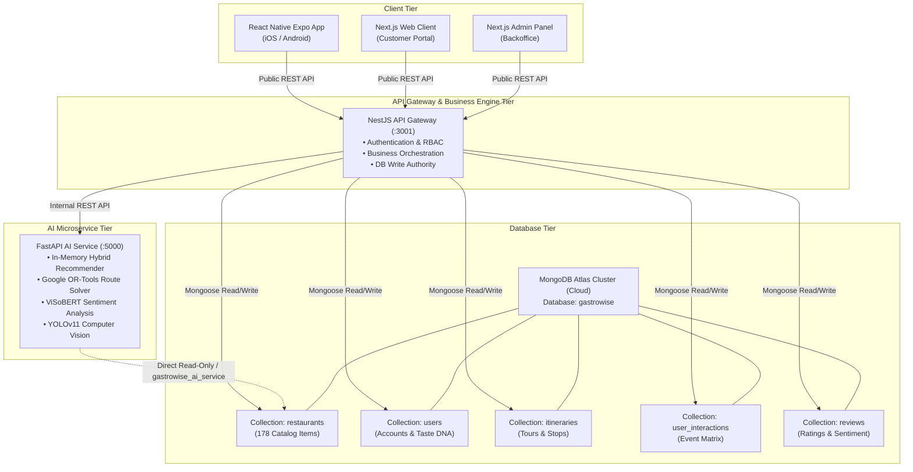

# GASTROWISE – ARCHITECTURE BOUNDARY & INTEGRATION AUDIT
**Sprint 0 System Architecture & Tier Responsibility Audit**  
**Role:** Principal Software Architect & QA Technical Lead  
**Audit Date:** November 17, 2026  
**Status:** AUDITED AGAINST CODEBASE

---

## 1. ARCHITECTURAL BOUNDARY OVERVIEW

The GastroWise platform architecture is partitioned into four primary tiers with distinct operational boundaries:



---

## 2. CORE RESPONSIBILITY & OWNERSHIP MATRIX

| Architectural Dimension | Responsible Service | Verified Source Code Implementation | Audit Verdict |
| :--- | :---: | :--- | :---: |
| **Restaurant Data Ownership** | **NestJS** | `KLTN-123-GastroWise-BE/src/restaurants/restaurants.service.ts` owns restaurant schema, CRUD, approval, and search. | **CORRECT** |
| **Database Write Authority** | **NestJS** | Mongoose models in NestJS are the sole writers to all collections. FastAPI has zero write permissions. | **CORRECT** |
| **AI Inference & Algorithms** | **FastAPI** | Vector cosine similarity, SVD collaborative filtering, OR-Tools TSPTW, and ViSoBERT live exclusively in FastAPI. | **CORRECT** |
| **Public Gateway Entrypoint** | **NestJS** | All mobile and web traffic targets NestJS (`:3001`). Mobile app never directly addresses FastAPI (`:5000`). | **CORRECT** |
| **User Identity & Ownership** | **NestJS** | JWT issuance and ownership verification (`itinerary.user_id === actorId`) are managed by NestJS. | **CORRECT** |
| **Service Authentication** | *Missing* | Neither NestJS nor FastAPI currently enforces `X-Internal-AI-Key` authentication headers. | **VIOLATION** |

---

## 3. FASTAPI DIRECT READ-ONLY ACCESS VS. NESTJS-MEDIATED ACCESS

FastAPI currently queries MongoDB Atlas directly at startup via `load_dataset_from_mongo()` in `app/db/mongo.py` using the dedicated least-privilege user `gastrowise_ai_service`.

### Architectural Tradeoff Analysis

```
┌───────────────────────────────────────────────┬───────────────────────────────────────────────┐
│ APPROACH A: Direct Read-Only (Current)       │ APPROACH B: NestJS-Mediated Sync (Pure Single)│
├───────────────────────────────────────────────┼───────────────────────────────────────────────┤
│ PROS:                                         │ PROS:                                         │
│ • Blazing startup: 1.2s to load 178 venues.   │ • Single Database Gateway: only NestJS has    │
│ • Zero load on NestJS during AI init.         │   Atlas credentials and network connectivity. │
│ • Clean Python DataFrame parsing.             │ • Zero DB credentials in AI Microservice.     │
│ • Pre-fits TF-IDF and SVD in memory.          │ • Real-time cache invalidation via webhooks.  │
│                                               │                                               │
│ CONS:                                         │ CONS:                                         │
│ • Data Staleness: New venues added in NestJS  │ • Cold startup requires paging HTTP requests  │
│   do not appear in AI until restart.          │   from NestJS to FastAPI.                     │
│ • Dual Atlas connections to monitor.          │ • Higher memory transfer overhead over REST.  │
│ • Does not scale past ~50,000 restaurants.    │                                               │
└───────────────────────────────────────────────┴───────────────────────────────────────────────┘
```

### Architectural Recommendation
- **Current Phase (178–5,000 restaurants):** Retain **Approach A (Direct Read-Only)** with `gastrowise_ai_service`. It is verified secure by Atlas RBAC (read on restaurants only, write blocked, users blocked) and achieves sub-second startup ($1.2\text{ s}$).
- **Required Stabilization Fix:** Add a catalog refresh endpoint in FastAPI (`POST /admin/refresh-catalog`) that NestJS calls when an admin creates or updates a restaurant, resolving the data staleness issue.
- **Future Scale (>50,000 restaurants):** Transition to on-demand candidate retrieval using MongoDB Atlas Vector Search or NestJS passing candidate subsets to FastAPI.

---

## 4. ARCHITECTURAL BOUNDARY FINDINGS

### FINDING ARCH-01: Cross-Tier API Routing Discrepancies Breaking Core AI Features
- **Severity:** CRITICAL
- **Evidence:** 
  - [KLTN-123-GastroWise-BE/src/restaurants/restaurants.service.ts:448](file:///D:/GastroWise/KLTN-123-GastroWise-BE/src/restaurants/restaurants.service.ts#L448) calls `${aiBaseUrl}/v1/recommendation/recommend/hybrid`.
  - [KLTN-123-GastroWise-BE/src/restaurants/restaurants.service.ts:547](file:///D:/GastroWise/KLTN-123-GastroWise-BE/src/restaurants/restaurants.service.ts#L547) calls `${aiBaseUrl}/v1/recommendation/cf/train`.
  - [KLTN-123-GastroWise-BE/src/restaurants/restaurants.service.ts:969](file:///D:/GastroWise/KLTN-123-GastroWise-BE/src/restaurants/restaurants.service.ts#L969) calls `${aiBaseUrl}/v1/copilot/message`.
  - [KLTN-123-GastroWise-AI/app/api/v1/router.py:9-15](file:///D:/GastroWise/KLTN-123-GastroWise-AI/app/api/v1/router.py#L9-L15) mounts endpoints without `/v1` prefix.
- **Actual Behavior:** All requests from NestJS to AI for hybrid recommendations, SVD collaborative filtering retraining, and Copilot chat fail with HTTP 404. NestJS catches errors and falls back to rudimentary database sorts and regex matching, completely disabling the AI platform.
- **Expected Behavior:** API route contracts must align so NestJS invokes live FastAPI endpoints without error.
- **Business Impact:** High-value AI features (Taste DNA personalization, SVD collaborative filtering, Copilot dialogue) never execute in production.
- **Recommended Solution:** Align URL paths between services. Update `restaurants.service.ts` to call `${aiBaseUrl}/recommend/hybrid`, `${aiBaseUrl}/cf/train`, and `${aiBaseUrl}/copilot/message`, or prefix all routers in `api_v1_router` with `/v1`.
- **Dependencies:** None.
- **Acceptance Criteria:** NestJS calls return 200 OK with `isColdStart` and `appliedWeights` populated from FastAPI.
- **Testing Requirements:** End-to-end integration test calling `GET /restaurants/recommended`.

---

### FINDING ARCH-02: Absence of Service-to-Service Mutual Authentication
- **Severity:** CRITICAL
- **Evidence:** [KLTN-123-GastroWise-AI/main.py:23-29](file:///D:/GastroWise/KLTN-123-GastroWise-AI/main.py#L23-L29), [KLTN-123-GastroWise-BE/src/restaurants/restaurants.service.ts](file:///D:/GastroWise/KLTN-123-GastroWise-BE/src/restaurants/restaurants.service.ts)
- **Actual Behavior:** FastAPI routes have zero authentication. Any client on the local network or internet reaching port 5000 can invoke heavy AI models, trigger SVD training, or consume server resources.
- **Expected Behavior:** FastAPI must only accept requests bearing a valid internal secret header (`X-Internal-AI-Key`).
- **Business Impact:** Service spoofing, unauthorized access to AI capabilities, and denial-of-service risks.
- **Recommended Solution:** Create an internal auth dependency in FastAPI verifying `X-Internal-AI-Key`; inject the header in NestJS `HttpService` requests.
- **Dependencies:** Environment variable `AI_SECRET_KEY` in both BE and AI.
- **Acceptance Criteria:** Direct requests to FastAPI without valid key return 401 Unauthorized.
- **Testing Requirements:** Integration test sending requests with and without the header.

---

### FINDING ARCH-03: Mobile Environment API Prefix Mismatch
- **Severity:** HIGH
- **Evidence:** [KLTN-123-GastroWise-Mobile/.env:6](file:///D:/GastroWise/KLTN-123-GastroWise-Mobile/.env#L6), [KLTN-123-GastroWise-BE/src/main.ts:8-53](file:///D:/GastroWise/KLTN-123-GastroWise-BE/src/main.ts#L8-L53)
- **Actual Behavior:** Mobile `.env` sets `EXPO_PUBLIC_API_URL=http://10.161.30.252:3001/api/v1`. However, NestJS `main.ts` does not call `app.setGlobalPrefix('api/v1')`. All routes exist at root (`/auth/login`, `/restaurants`).
- **Expected Behavior:** API client and Gateway base paths must match.
- **Business Impact:** Mobile requests to `/api/v1/auth/login` fail with 404 when tested against the configured environment URL.
- **Recommended Solution:** Add `app.setGlobalPrefix('api/v1')` in NestJS `main.ts` (with exclusion for static `/uploads/`).
- **Dependencies:** Frontend web clients must verify base URL alignment.
- **Acceptance Criteria:** `POST /api/v1/auth/login` returns 200 OK.
- **Testing Requirements:** Test auth endpoint with `/api/v1` prefix.

