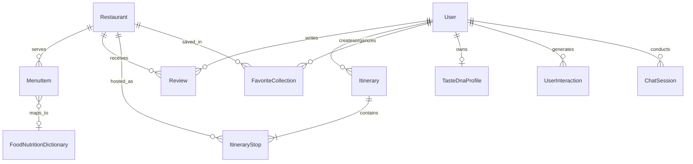

# GASTROWISE - DATABASE SCHEMA SPECIFICATION
## Comprehensive MongoDB Architecture & Phase 2 Evolution

**Database System:** MongoDB Atlas (Replica Set)  
**ORM / ODM:** Mongoose 8.x / PyMongo 4.x  
**Coordinate Standard:** GeoJSON (WGS84 EPSG:4326)  

---

## 1. Entity-Relationship Architecture (Mermaid Diagram)



---

## 2. Core Collections Specification (Existing & Verified)

### 2.1. `users` Collection
Stores credential hashes, role assignments, profile metadata, and security settings.

```typescript
@Schema({ timestamps: true })
export class User {
  _id: mongoose.Types.ObjectId;
  username: string;                   // Unique username
  email: string;                      // Unique email (indexed)
  password: string;                   // Bcrypt hash (rounds: 10)
  picture?: string;                   // Avatar URL
  firstName?: string;
  lastName?: string;
  phone?: string;
  company?: string;
  designation?: string;
  bio?: string;
  role: 'user' | 'admin' | 'owner';   // Default: 'user'
  preferences: string[];              // Legacy raw preferences strings
  savedRestaurants: ObjectId[];       // References to restaurants collection
  status: 'active' | 'banned';        // Default: 'active'
  twoFactorSecret?: string;           // Base32 TOTP secret
  isTwoFactorEnabled?: boolean;       // Default: false
  resetOtp?: string;                  // 6-digit transient password reset token
  hashedRefreshToken?: string;        // Hashed JWT refresh token
  createdAt: Date;
  updatedAt: Date;
}
```
**Indexes:**
- `{ email: 1 }` (Unique)
- `{ username: 1 }` (Unique)
- `{ role: 1, status: 1 }`

---

### 2.2. `restaurants` Collection
Stores restaurant operational metadata, reviews aggregates, and geographic data.

```typescript
@Schema({ collection: 'restaurants', timestamps: true })
export class Restaurant {
  _id: mongoose.Types.ObjectId;
  tenQuan: string;                    // Restaurant name
  cityId: string;                     // City code (e.g. 'hcm')
  diemTrungBinh: number;              // Average rating [1.0 - 10.0 or 1.0 - 5.0]
  diaChi: string;                     // Full physical address
  gioMoCua: string;                   // Opening hours string (e.g. "08:00 - 22:00")
  giaCa: string;                      // Price range string (e.g. "50.000đ - 200.000đ")
  tags: string;                       // Comma-separated keywords & categories
  lat: number;                        // Latitude float
  lon: number;                        // Longitude float
  
  // Phase 2 Addition: Native GeoJSON
  location: {
    type: 'Point';
    coordinates: [number, number];    // [lon, lat] format
  };

  diemKhongGian: number;              // Sub-rating: Ambience
  diemViTri: number;                  // Sub-rating: Location accessibility
  diemChatLuong: number;              // Sub-rating: Food quality
  diemPhucVu: number;                 // Sub-rating: Service
  diemGiaCa: number;                  // Sub-rating: Price value
  avatarUrl: string;                  // Thumbnail image URL
  urlGoc: string;                     // Origin external reference URL
  ownerId?: ObjectId;                 // Reference to merchant User
  slug?: string;                      // URL-safe unique slug
  description?: string;
  contactPhone?: string;
  reviewsCount: number;               // Total review counter
  status: 'open' | 'closed' | 'pending';
  isVerified: boolean;                // Merchant verified partner
  isFeatured: boolean;                // AI curated / prioritized badge
  createdAt: Date;
  updatedAt: Date;
}
```
**Indexes:**
- `{ location: "2dsphere" }` *(Phase 2 Crucial Index)*
- `{ cityId: 1 }`
- `{ slug: 1 }` (Sparse)
- `{ diemTrungBinh: -1, isFeatured: -1 }` (Compound discovery index)

---

### 2.3. `menu_items` Collection
Stores granular culinary items served by each restaurant.

```typescript
@Schema({ collection: 'menu_items', timestamps: true })
export class MenuItem {
  _id: mongoose.Types.ObjectId;
  restaurantId: mongoose.Types.ObjectId; // References restaurants._id
  name: string;                          // Dish name
  description?: string;
  price: number;                         // In VND
  image?: string;
  isVegetarian: boolean;                 // Meat-free flag
  calories?: number;                     // Estimated caloric content
  tags: string[];                        // Dietary tags
  isAvailable: boolean;                  // In-stock flag (Default: true)
  isFeatured: boolean;                   // Chef's pick badge (Default: false)
  createdAt: Date;
  updatedAt: Date;
}
```
**Indexes:**
- `{ restaurantId: 1, isAvailable: 1 }`
- `{ name: "text", tags: "text" }`

---

### 2.4. `itineraries` Collection
Stores user-created and AI-optimized culinary journeys, routing stops, and audit trail.

```typescript
export class ItineraryStop {
  stop_id: string;                       // UUID v4
  restaurant_id: ObjectId;              // References restaurants._id
  order_index: number;                   // Sequence in tour (0, 1, 2...)
  restaurant_name: string;
  restaurant_lat: number;
  restaurant_lng: number;
  arrival_time?: string;                 // Phase 2: Planned arrival time
  dining_duration_mins?: number;         // Phase 2: Expected duration (mins)
  transit_time_mins?: number;            // Phase 2: Travel time from previous
  distance_to_next_m?: number;           // Phase 2: Road distance to next stop
}

@Schema({ timestamps: true })
export class Itinerary {
  _id: mongoose.Types.ObjectId;
  user_id: ObjectId;                     // References users._id
  prompt: string;                        // User input prompt
  title: string;                         // Generated route title
  start_time: string;                    // Time boundary start
  end_time: string;                      // Time boundary end
  budget: number;                        // Maximum expenditure in VND
  start_location: {
    type: 'Point';
    coordinates: [number, number];       // [lon, lat]
  };
  status: 'generated' | 'confirmed' | 'completed' | 'cancelled';
  stops: ItineraryStop[];
  shareToken?: string;
  reminderEnabled: boolean;
  reminderTime: string;                  // '30_MIN' | '1_HOUR' | '2_HOUR'
  co2SavedKg: number;                    // Estimated emission reduction
  confirmedBy?: ObjectId;
  confirmedAt?: Date;
  cancelledBy?: ObjectId;
  cancelledAt?: Date;
  completedBy?: ObjectId;
  completedAt?: Date;
  createdAt: Date;
  updatedAt: Date;
}
```
**Indexes:**
- `{ user_id: 1, createdAt: -1 }`
- `{ status: 1 }`
- `{ shareToken: 1 }` (Sparse)

---

### 2.5. `reviews` Collection
Stores customer reviews, star ratings, and AI sentiment analysis results.

```typescript
@Schema({ collection: 'reviews', timestamps: true })
export class Review {
  _id: mongoose.Types.ObjectId;
  tenQuan: string;
  urlGoc: string;
  diemReview: number;                    // Star rating (1 - 5)
  noiDung: string;                       // Review text
  aiSentimentLabel: string;              // 'POSITIVE' | 'NEUTRAL' | 'NEGATIVE'
  aiSentimentScore: number;              // Confidence [0.0 - 1.0]
  hashtags: string[];                    // Extracted hashtags
  userId?: ObjectId;                     // Optional user reference
  userName?: string;
  restaurantId: ObjectId;                // References restaurants._id
  images: string[];
  likes: number;
  status: 'active' | 'hidden' | 'pending';
  isFeatured: boolean;
  pinnedAt?: Date;
  createdAt: Date;
  updatedAt: Date;
}
```
**Indexes:**
- `{ restaurantId: 1, createdAt: -1 }`
- `{ aiSentimentLabel: 1 }`

---

## 3. Phase 2 New Schema Additions

### 3.1. `taste_dna_profiles` (Phase P1)
Normalized numerical representation of diner taste dimensions.

```typescript
@Schema({ collection: 'taste_dna_profiles', timestamps: true })
export class TasteDnaProfile {
  _id: mongoose.Types.ObjectId;
  
  @Prop({ type: mongoose.Schema.Types.ObjectId, ref: 'User', required: true, unique: true })
  userId: mongoose.Types.ObjectId;

  // 6-Dimensional Normalized Taste Vector [0.0 - 1.0]
  @Prop({
    type: {
      spicy: { type: Number, default: 0.5, min: 0, max: 1 },
      sweet: { type: Number, default: 0.5, min: 0, max: 1 },
      sour:  { type: Number, default: 0.5, min: 0, max: 1 },
      salty: { type: Number, default: 0.5, min: 0, max: 1 },
      umami: { type: Number, default: 0.5, min: 0, max: 1 },
      bitter:{ type: Number, default: 0.2, min: 0, max: 1 },
    },
    _id: false,
    required: true,
  })
  flavor_vector: {
    spicy: number;
    sweet: number;
    sour: number;
    salty: number;
    umami: number;
    bitter: number;
  };

  @Prop({ type: [String], default: [] })
  dietary_constraints: string[];         // ['vegan', 'halal', 'low_carb', 'no_seafood']

  @Prop({ type: Map, of: Number, default: {} })
  cuisine_weights: Map<string, number>;  // {'vietnamese': 0.9, 'bbq': 0.7, 'japanese': 0.5}

  @Prop({ default: 2, min: 1, max: 4 })
  preferred_price_tier: number;          // 1: Budget (<100k), 2: Mid, 3: High, 4: Luxury

  @Prop({ default: 0 })
  total_interactions_count: number;

  @Prop({ default: Date.now })
  last_reinforced_at: Date;
}
```
**Indexes:**
- `{ userId: 1 }` (Unique)

---

### 3.2. `user_interactions` (Phase P0 / P2)
Streaming event log for implicit signals driving collaborative filtering and CTR evaluation.

```typescript
@Schema({ collection: 'user_interactions', timestamps: { createdAt: true, updatedAt: false } })
export class UserInteraction {
  _id: mongoose.Types.ObjectId;

  @Prop({ type: mongoose.Schema.Types.ObjectId, ref: 'User', index: true })
  userId?: mongoose.Types.ObjectId;

  @Prop({ required: true, index: true })
  sessionId: string;                     // For tracking guests & sessions

  @Prop({
    required: true,
    enum: [
      'VIEW_RESTAURANT',
      'VIEW_MENU_ITEM',
      'CLICK_RECOMMENDATION',
      'DISMISS_RECOMMENDATION',
      'ADD_TO_FAVORITES',
      'REMOVE_FROM_FAVORITES',
      'GENERATE_ITINERARY',
      'COMPLETE_ITINERARY',
      'SHARE_ITINERARY',
      'CALL_RESTAURANT',
      'OPEN_MAPS',
    ],
  })
  eventType: string;

  @Prop({ required: true, enum: ['restaurant', 'menu_item', 'itinerary'] })
  targetType: string;

  @Prop({ type: mongoose.Schema.Types.ObjectId, required: true, index: true })
  targetId: mongoose.Types.ObjectId;

  @Prop({ default: 0 })
  dwellTimeMs: number;                   // Time spent looking at item/restaurant

  @Prop({ type: Object, default: {} })
  context: {
    lat?: number;
    lon?: number;
    weather_type?: string;
    temperature?: number;
    recommendation_algorithm?: string;  // 'hybrid_v1' | 'content_v1' | 'weather_v1'
  };

  createdAt: Date;
}
```
**Indexes:**
- `{ userId: 1, createdAt: -1 }`
- `{ targetId: 1, eventType: 1 }`
- `{ eventType: 1, createdAt: -1 }`
- TTL Index: `{ createdAt: 1 }, expireAfterSeconds: 7776000` (90-day retention)

---

### 3.3. `food_nutrition_dictionary` (Phase P4)
Lookup registry mapping detected YOLO food classes to standardized nutrition metrics.

```typescript
@Schema({ collection: 'food_nutrition_dictionary', timestamps: true })
export class FoodNutritionDictionary {
  _id: mongoose.Types.ObjectId;

  @Prop({ required: true, unique: true })
  class_name: string;                    // e.g. "pho_bo", "banh_mi", "bun_bo_hue"

  @Prop({ required: true })
  vietnamese_name: string;               // "Phở Bò Tái Nạm"

  @Prop({ required: true })
  serving_size: string;                  // "1 Tô (500g)"

  @Prop({ required: true })
  calories: number;                      // kcal

  @Prop({ required: true })
  protein_g: number;

  @Prop({ required: true })
  carbs_g: number;

  @Prop({ required: true })
  fat_g: number;

  @Prop({ type: [String], default: [] })
  matching_tags: string[];               // ['PHỞ', 'MÓN NƯỚC', 'BÒ']

  @Prop()
  dietary_advice: string;
}
```
**Indexes:**
- `{ class_name: 1 }` (Unique)

---

## 4. Migration Plan & Safe Backfill Scripts

### P0-MIG-01: Backfilling `location` on `restaurants`
```javascript
// Migration Script: backfill-geojson.js
// Run via: node migrations/backfill-geojson.js
const { MongoClient } = require('mongodb');

async function migrate() {
  const client = new MongoClient(process.env.MONGODB_URI);
  await client.connect();
  const db = client.db('gastrowise');
  const collection = db.collection('restaurants');

  console.log('Starting Geospatial backfill...');
  const cursor = collection.find({ location: { $exists: false }, lat: { $ne: null }, lon: { $ne: null } });
  
  let count = 0;
  while (await cursor.hasNext()) {
    const doc = await cursor.next();
    if (doc.lat && doc.lon && !isNaN(doc.lat) && !isNaN(doc.lon)) {
      await collection.updateOne(
        { _id: doc._id },
        {
          $set: {
            location: {
              type: 'Point',
              coordinates: [parseFloat(doc.lon), parseFloat(doc.lat)],
            },
          },
        }
      );
      count++;
    }
  }

  console.log(`Backfilled ${count} restaurants. Creating 2dsphere index...`);
  await collection.createIndex({ location: '2dsphere' });
  console.log('2dsphere index successfully created!');
  await client.close();
}

migrate().catch(console.error);
```

