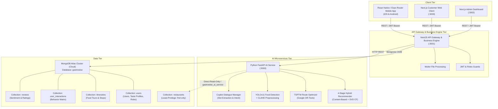
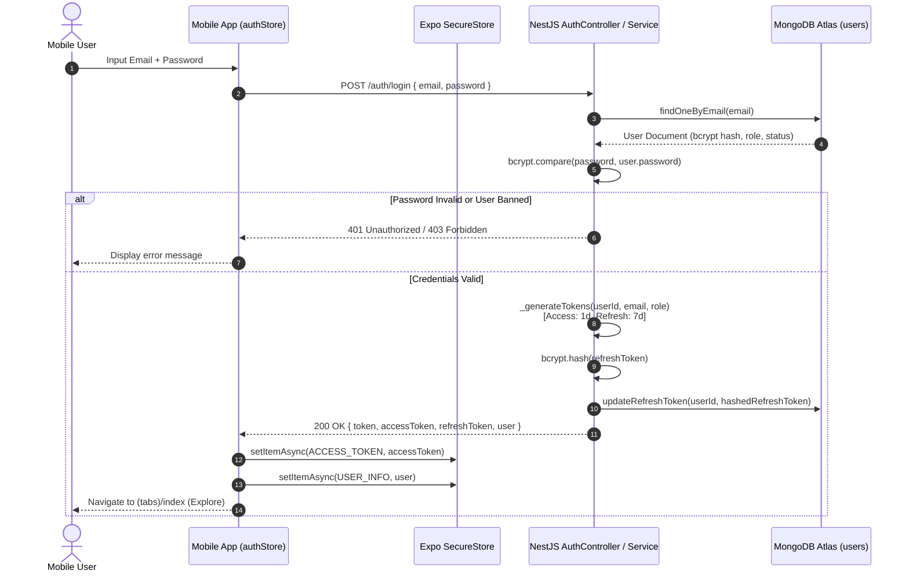
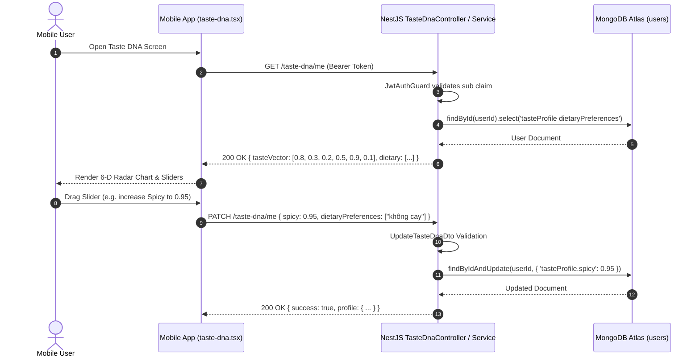
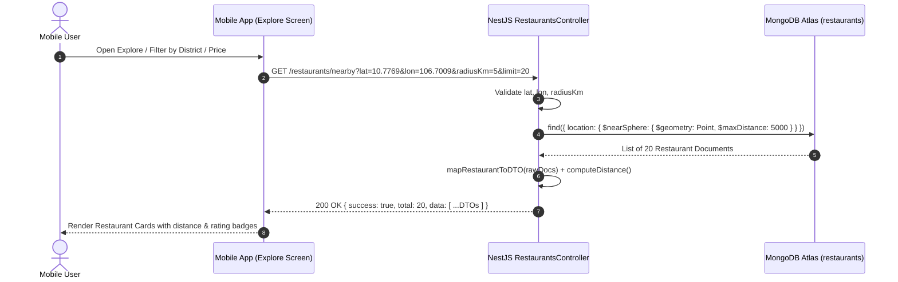
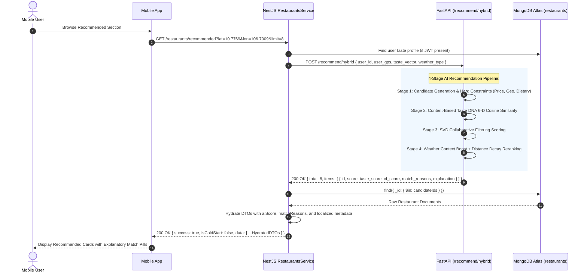
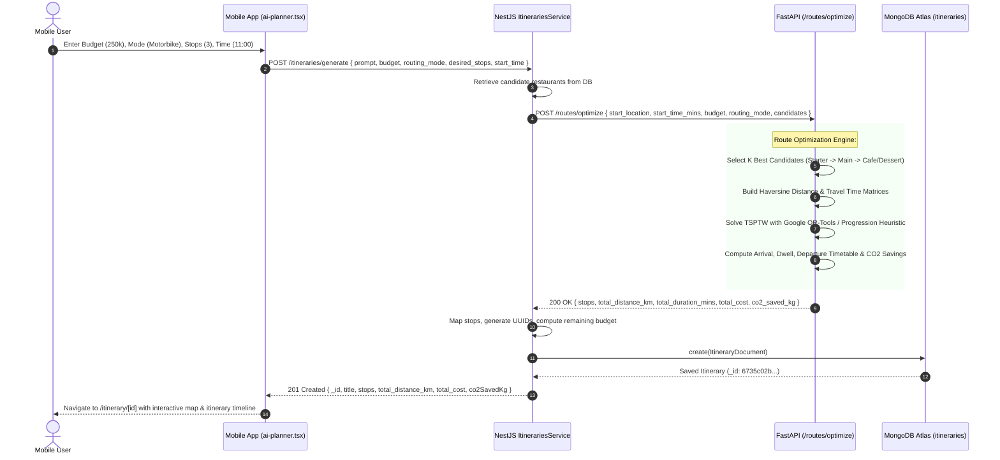
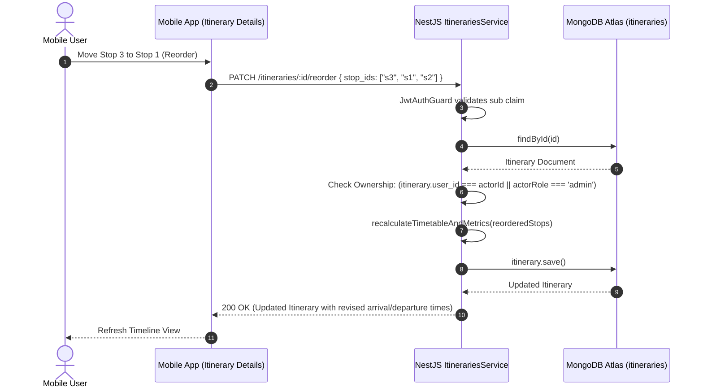
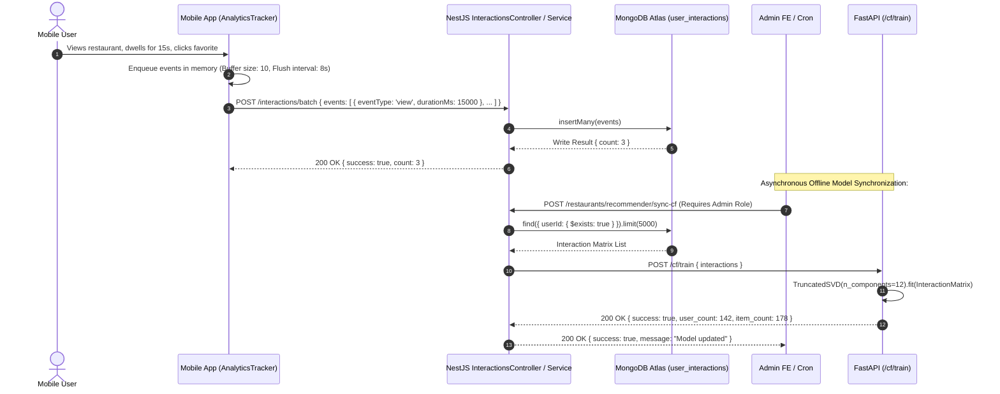
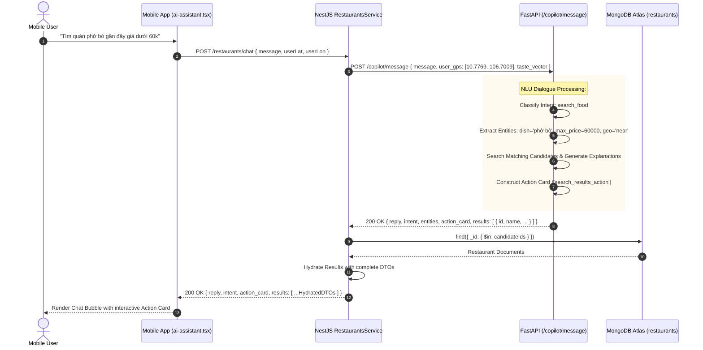

# GASTROWISE – END-TO-END DATA FLOW & ARCHITECTURE SPECIFICATION
**Sprint 2 Technical Architecture Audit**  
**Role:** Principal Software Architect & QA Technical Lead  
**Audit Date:** November 2026  
**Status:** VERIFIED AGAINST CODEBASE

---

## 1. SYSTEM ARCHITECTURAL TOPOLOGY

The GastroWise platform is structured into four primary architectural tiers:



---

## 2. VERIFIED END-TO-END DATA FLOWS

### FLOW 1: USER AUTHENTICATION & SESSION MANAGEMENT
Handles user registration, credential verification, bcrypt password hashing, dual JWT token generation (Access & Refresh), refresh rotation, and logout.

#### Architecture Components:
- **Client:** `KLTN-123-GastroWise-Mobile/src/store/authStore.ts`
- **Gateway:** `KLTN-123-GastroWise-BE/src/auth/auth.controller.ts` $\rightarrow$ `auth.service.ts`
- **Database:** MongoDB Atlas `gastrowise.users`
- **AI Service:** None (Strictly isolated from auth)

#### Sequence Diagram:


#### DTO & Payload Definitions:
- **Request (`LoginDto`):**
  ```json
  {
    "email": "user@gastrowise.vn",
    "password": "SecurePassword123!"
  }
  ```
- **Response (`200 OK`):**
  ```json
  {
    "token": "eyJhbGciOiJIUzI1NiIsInR5cCI6IkpXVCJ9...",
    "accessToken": "eyJhbGciOiJIUzI1NiIsInR5cCI6IkpXVCJ9...",
    "refreshToken": "eyJhbGciOiJIUzI1NiIsInR5cCI6IkpXVCJ9...",
    "user": {
      "id": "6724b112988cb148b897824b",
      "email": "user@gastrowise.vn",
      "name": "Nguyễn Văn A",
      "role": "user",
      "tasteProfile": {
        "spicy": 0.8,
        "sweet": 0.3,
        "sour": 0.2,
        "salty": 0.5,
        "umami": 0.9,
        "bitter": 0.1
      }
    }
  }
  ```

---

### FLOW 2: TASTE DNA RETRIEVAL & UPDATE
Allows users to retrieve their 6-dimensional gastronomic taste profile, calibrate radar chart preferences, and submit initial onboarding quiz vectors.

#### Architecture Components:
- **Client:** `KLTN-123-GastroWise-Mobile/src/app/profile/taste-dna.tsx`
- **Gateway:** `KLTN-123-GastroWise-BE/src/taste-dna/taste-dna.controller.ts` $\rightarrow$ `taste-dna.service.ts`
- **Database:** MongoDB Atlas `gastrowise.users` (`tasteProfile` subdocument)
- **AI Service:** None directly (Taste vector is used in Flow 4)

#### Sequence Diagram:


---

### FLOW 3: RESTAURANT DISCOVERY (GEOJSON 2DSPHERE & TEXT SEARCH)
High-performance spatial querying and full-text restaurant discovery based on device GPS coordinates, maximum distance radius, keyword search, price range, and category tags.

#### Architecture Components:
- **Client:** `KLTN-123-GastroWise-Mobile/src/app/(tabs)/index.tsx`, `explore.tsx`
- **Gateway:** `KLTN-123-GastroWise-BE/src/restaurants/restaurants.controller.ts` $\rightarrow$ `restaurants.service.ts`
- **Database:** MongoDB Atlas `gastrowise.restaurants` (Indexes: `location: "2dsphere"`, `tenQuan_text_diaChi_text_monAnTags_text`)
- **AI Service:** None (Direct DB spatial index query)

#### Sequence Diagram:


---

### FLOW 4: HYBRID PERSONALIZED RECOMMENDATIONS (4-STAGE AI PIPELINE)
The primary intelligence pipeline of GastroWise, orchestrating candidate retrieval, 6-D Taste DNA content-based cosine similarity, TruncatedSVD Collaborative Filtering, and contextual weather/distance boosting.

#### Architecture Components:
- **Client:** `KLTN-123-GastroWise-Mobile/src/app/(tabs)/index.tsx`
- **Gateway:** `KLTN-123-GastroWise-BE/src/restaurants/restaurants.service.ts`
- **AI Service:** `KLTN-123-GastroWise-AI/app/api/v1/recommendation.py` $\rightarrow$ `recommender.py` + `collaborative_filter.py`
- **Database:** MongoDB Atlas `gastrowise.restaurants` (Hydration)

#### Sequence Diagram:


> [!WARNING]
> **API Contract Mismatch Identified:** NestJS `restaurants.service.ts:448` currently invokes `${aiBaseUrl}/v1/recommendation/recommend/hybrid`. FastAPI mounts the endpoint at `${aiBaseUrl}/recommend/hybrid`. This discrepancy produces an HTTP 404, which causes NestJS to trigger `getFallbackRecommendations()`, masking the AI recommendation engine with a basic rating-sorted database fallback!

---

### FLOW 5: AI ITINERARY GENERATION (OR-TOOLS TSPTW)
Transforms user time windows, budget limits, transportation modes, and food preferences into an optimized multi-stop gastronomic itinerary using Google OR-Tools.

#### Architecture Components:
- **Client:** `KLTN-123-GastroWise-Mobile/src/app/ai-planner.tsx`
- **Gateway:** `KLTN-123-GastroWise-BE/src/itineraries/itineraries.controller.ts` $\rightarrow$ `itineraries.service.ts`
- **AI Service:** `KLTN-123-GastroWise-AI/app/api/v1/routing.py` $\rightarrow$ `route_optimizer.py`
- **Database:** MongoDB Atlas `gastrowise.itineraries`

#### Sequence Diagram:


---

### FLOW 6: ITINERARY MANAGEMENT & RECALCULATION
Empowers users to customize generated itineraries: reordering stops, adding new venues, removing stops, and recalculating routes with dynamic TSP recalculation.

#### Architecture Components:
- **Client:** `KLTN-123-GastroWise-Mobile/src/app/itinerary/[id].tsx`
- **Gateway:** `KLTN-123-GastroWise-BE/src/itineraries/itineraries.controller.ts` $\rightarrow$ `itineraries.service.ts`
- **Database:** MongoDB Atlas `gastrowise.itineraries`

#### Sequence Diagram:


---

### FLOW 7: INTERACTION TRACKING & SVD RETRAINING PIPELINE
Captures user behavioral interactions in the mobile app, batches them in local queues, flushes them to NestJS, and exports the interaction matrix to train the Collaborative Filtering model.

#### Architecture Components:
- **Client:** `KLTN-123-GastroWise-Mobile/src/lib/analytics/tracker.ts`
- **Gateway:** `KLTN-123-GastroWise-BE/src/interactions/interactions.service.ts`
- **Database:** MongoDB Atlas `gastrowise.user_interactions`
- **AI Service:** `KLTN-123-GastroWise-AI/app/api/v1/recommendation.py` $\rightarrow$ `collaborative_filter.py`

#### Sequence Diagram:


---

### FLOW 8: AI COPILOT & CHAT DIALOGUE ORCHESTRATION
Processes natural language culinary inquiries, extracts user intent and entities, queries candidate restaurants, and formats response cards with actionable mobile navigation links.

#### Architecture Components:
- **Client:** `KLTN-123-GastroWise-Mobile/src/app/ai-assistant.tsx`
- **Gateway:** `KLTN-123-GastroWise-BE/src/restaurants/restaurants.controller.ts` $\rightarrow$ `restaurants.service.ts`
- **AI Service:** `KLTN-123-GastroWise-AI/app/api/v1/copilot.py` $\rightarrow$ `nlu_service.py`
- **Database:** MongoDB Atlas `gastrowise.restaurants` (Candidate hydration)

#### Sequence Diagram:


> [!WARNING]
> **API Contract Mismatch Identified:** NestJS `restaurants.service.ts:969` invokes `${aiBaseUrl}/v1/copilot/message`. FastAPI mounts the endpoint at `${aiBaseUrl}/copilot/message`. This discrepancy produces an HTTP 404, prompting NestJS to execute regex-based keyword search fallback!

---

## 3. SUMMARY OF IDENTIFIED CONTRACT & ROUTING MISMATCHES

| Item | Origin Tier | Target Tier | Called Endpoint | Actual Route in Target | Impact | Remediation |
| :--- | :--- | :--- | :--- | :--- | :--- | :--- |
| **MIS-01** | Mobile Client | NestJS Gateway | `${EXPO_PUBLIC_API_URL}/auth/login`<br/>(`.../api/v1/auth/login`) | `POST /auth/login` | Mobile calls return 404 unless `.env` omits `/api/v1` or NestJS adds global prefix. | Set `app.setGlobalPrefix('api/v1')` in NestJS `main.ts` or update Mobile `.env`. |
| **MIS-02** | NestJS Gateway | FastAPI Service | `POST /v1/recommendation/recommend/hybrid` | `POST /recommend/hybrid` | AI Hybrid recommendations return 404 $\rightarrow$ fallback rating sort is always served. | Align FastAPI prefix with `/v1/recommendation` or change BE call to `/recommend/hybrid`. |
| **MIS-03** | NestJS Gateway | FastAPI Service | `POST /v1/recommendation/cf/train` | `POST /cf/train` | Interaction matrix sync returns 404 $\rightarrow$ SVD model is never retrained from BE. | Align FastAPI prefix or update BE call to `/cf/train`. |
| **MIS-04** | NestJS Gateway | FastAPI Service | `POST /v1/copilot/message` | `POST /copilot/message` | AI Copilot returns 404 $\rightarrow$ regex fallback is always returned to user. | Align FastAPI router prefix to `/v1/copilot` or update BE call to `/copilot/message`. |
| **MIS-05** | NestJS Gateway | MongoDB / Mobile | `duration_mins`, `transit_to_next_mins` | `dining_duration_mins`, `transit_time_mins` | Inconsistent naming in `itineraries.service.ts` causes Mongoose default fallbacks. | Normalize property names across `itinerary.schema.ts`, `itineraries.service.ts`, and Mobile UI. |

