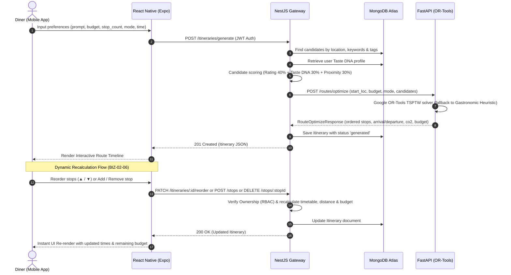

# GASTROWISE - ARCHITECTURE & SPECIFICATION
## Smart Food Journey & Route Optimization Engine (TASK-BIZ-02)

**Author:** Principal Software Architect, Senior Backend Engineer, AI Optimization Engineer  
**Date:** November 2026  
**Status:** IMPLEMENTED & VERIFIED  
**Components Covered:**
- Mobile Client: `KLTN-123-GastroWise-Mobile/src/app/ai-planner.tsx`, `src/app/itinerary/[id].tsx`
- Backend Gateway: `KLTN-123-GastroWise-BE/src/itineraries`
- AI Microservice: `KLTN-123-GastroWise-AI/app/core/route_optimizer.py`, `app/schemas/routing.py`, `app/api/v1/routing.py`

---

## 1. Architectural Overview & Workflow

The GastroWise Smart Food Journey & Route Optimization engine optimizes multi-stop culinary tours for diners in urban Ho Chi Minh City. Unlike standard vehicle routing, gastronomic tour optimization requires balancing travel distance, strict restaurant opening hours, meal progression sequence (Starter $\to$ Main $\to$ Dessert/Cafe), budget constraints, and user Taste DNA alignment.

### End-to-End System Sequence Diagram

---

## 2. Business Logic Modules

### 2.1. Candidate Generation & Selection (`BIZ-02-01`)
1. **Keyword & District Matching:** Analyzes user natural language prompt to identify culinary category (`chay`, `lẩu`, `nướng`, `cafe`, `trà sữa`, etc.) and administrative districts (`Quận 1`, `Gò Vấp`, `Bình Thạnh`, etc.).
2. **Proximity Filtering:** Filters restaurants located within reasonable urban driving range ($\le 25$ km) from the user's start location.
3. **Composite Candidate Scoring:**
   $$\text{Score} = 0.40 \cdot \frac{\text{Rating}}{5.0} + 0.30 \cdot \text{TasteAffinity} + 0.30 \cdot \max\left(0, 1 - \frac{\text{Distance}}{25}\right)$$
   - $\text{TasteAffinity}$: Calculated via user Taste DNA vector (dietary restrictions, spicy/sweet preferences, favorite cuisines).
4. **Budget Feasibility:** Excludes restaurants whose standalone price exceeds the user's declared total budget.
5. **Gastronomic Diversity:** Categorizes candidates into `starter`, `main`, `dessert`, `cafe` to guarantee a complete and diverse meal experience.

### 2.2. Real Travel Distance & Duration Model (`BIZ-02-02`)
1. **Road Detour Factor:** In Ho Chi Minh City urban street network, straight-line (Haversine) distance underestimates actual road travel due to one-way streets, alleys, and traffic routing. A calibrated urban detour factor is applied:
   $$d_{\text{road}}(p_1, p_2) = d_{\text{Haversine}}(p_1, p_2) \times 1.35$$
2. **Transit Speeds by Transport Mode:**
   | Mode | Velocity ($v$) | Minimum Transit Duration | Use Case |
   | :--- | :---: | :---: | :--- |
   | `motorbike` (Xe máy) | 24.0 km/h | 3 minutes | Standard urban travel in HCM |
   | `car` (Ô tô / Taxi) | 18.0 km/h | 5 minutes | Group travel with traffic congestion |
   | `walking` (Đi bộ) | 4.5 km/h | 5 minutes | Walking food tours & night markets |
3. **Transit Time Calculation:**
   $$\tau_{\text{transit}} = \max\left(\tau_{\min}, \text{round}\left(\frac{d_{\text{road}}}{v} \times 60\right)\right)$$

### 2.3. Time Constraint Optimization (`BIZ-02-03`)
1. **Time Representation:** All times are parsed to scalar minutes from midnight ($0 \le m \le 1440$).
2. **Schedule Computation:**
   - Arrival time: $A_i = D_{i-1} + \tau_{\text{transit}}(i-1, i)$
   - Actual Arrival (accounting for opening hours): $A_i^* = \max(A_i, \text{open}_i)$
   - Departure time: $D_i = A_i^* + \tau_{\text{dining}}(i)$ (default dining duration: 45 minutes)
3. **Closing Boundary Validation:** Validates that $A_i^* \le \text{close}_i$. If a restaurant is closed during the arrival window, it is penalized or pruned.

### 2.4. Budget Constraint Optimization (`BIZ-02-04`)
1. **Estimated Cost Tracking:** Each stop maintains an `estimated_cost` based on the restaurant's average dish price.
2. **Total Cost & Remaining Budget:**
   $$\text{total\_cost} = \sum_{i=1}^K \text{estimated\_cost}_i$$
   $$\text{remaining\_budget} = \max(0, \text{budget} - \text{total\_cost})$$
3. **Dynamic Budget Alert:** If adding a stop causes `remaining_budget < 0`, the UI clearly signals the budget overrun to the diner.

### 2.5. Google OR-Tools Route Optimizer (`BIZ-02-05`)
1. **Solver Formulation:** Formulated as Traveling Salesperson Problem with Time Windows (TSPTW) using `pywrapcp.RoutingModel`.
2. **Dimensions:**
   - Arc Cost: Minimizes road distance.
   - Time Dimension: Adds transit time + dwell duration with up to 180 minutes waiting slack.
   - Node Time Windows: Constrained to $[\text{open}_i, \text{close}_i]$.
   - Start Node: Fixed to start location with time window $[t_{\text{start}}, t_{\text{start}} + 15]$.
3. **Search Metaheuristics:**
   - First Solution: `PATH_CHEAPEST_ARC`
   - Local Search: `GUIDED_LOCAL_SEARCH` with 500ms time limit.
4. **Deterministic Heuristic Fallback:** If OR-Tools finds no feasible route due to tight time windows or microservice unavailability, the system falls back to `Gastronomic Progression Heuristic` ordering (`starter` $\to$ `main` $\to$ `dessert/cafe`) with nearest-neighbor road distance tie-breaking.

### 2.6. Dynamic Itinerary Recalculation (`BIZ-02-06`)
Supports dynamic modifications of generated itineraries without creating orphan records:
- **`PATCH /itineraries/:id/reorder`**: Re-sequences stops according to user drag-and-drop or Up/Down buttons, recalculating sequential arrival times, transit distances, total duration, and CO2 savings.
- **`POST /itineraries/:id/stops`**: Adds a selected restaurant into the itinerary, updates sequence numbers, and recalculates timetables and budget.
- **`DELETE /itineraries/:id/stops/:stopId`**: Removes a stop, re-indexes remaining stops $1 \dots N$, and recalculates the itinerary.
- **`POST /itineraries/:id/recalculate`**: Re-runs route optimization with modified constraints (budget, transport mode, start time).

---

## 3. Carbon Emissions Model

Urban road optimization directly prevents unguided, repetitive driving. The estimated CO2 saved is calculated against an unoptimized baseline (1.35x detour wandering factor):
$$\Delta d = \max\left(0.5, d_{\text{total}} \times 1.35 - d_{\text{total}}\right)$$
$$\text{CO}_2\text{ Saved (kg)} = \Delta d \times 0.104 \text{ kg CO}_2\text{/km}$$
*Vietnam urban fleet blend: 75% motorbikes @ 0.082 kg/km + 25% cars @ 0.171 kg/km = 0.104 kg CO2/km.*

---

## 4. Verification & Test Evidence

All itinerary services and controllers are verified via comprehensive Jest unit tests:
- **`itineraries.service.spec.ts`**: 10 tests passed (Haversine 1.35x detour factor, time string parsing, taste scoring, reorder stops, add stop, remove stop, recalculate itinerary, RBAC ownership checks, taste reinforcement).
- **`itineraries.controller.spec.ts`**: 5 tests passed (controller endpoints calling service methods with actor authorization).
- **`KLTN-123-GastroWise-BE` TypeScript Compilation**: 0 errors (`npx tsc --noEmit`).
- **`KLTN-123-GastroWise-Mobile` TypeScript Compilation**: 0 errors (`npx tsc --noEmit`).

